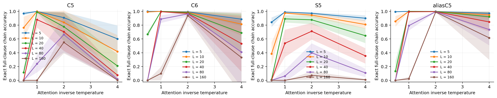
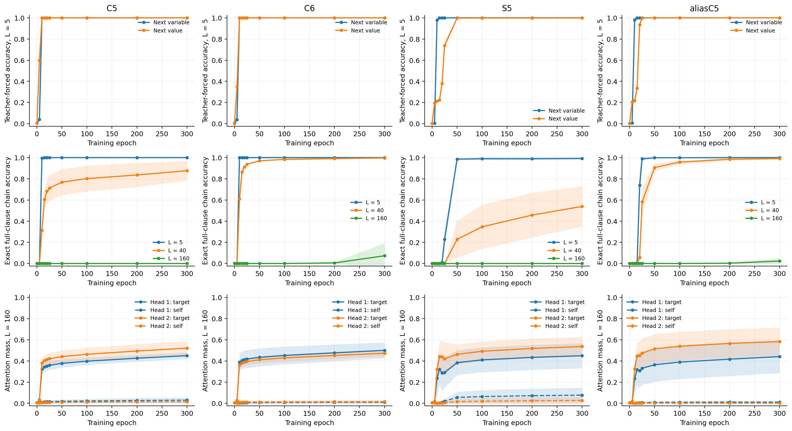

# 会话恢复与第一轮实验结果（2026-11-09）

## 恢复状态

已定位原 session `01a1bf41-12bb-77f2-b12d-9a95cdae600f`。错误中的 item ID 与该 session 的失败记录一致。通过明文用户请求、工具操作记录和工作区重建任务；未解密、修改或修复旧加密条目。

原任务：阅读指定 NeurIPS 2025 论文，研究 CoT 形成动力学与作用，开展复现和拓展实验。用户选择“可持续数小时，优先完整复现”；最后尚未回答的问题为“有什么有意思的结果吗”。

12 个基线模型和 9 个递归自训练阶段均完成；12 个基线的上下文干扰与固定面板动力学分析也已完成。此次接续读取并汇总已有结果，没有重新训练模型。21 个最终评测文件均标记 complete，且引用的检查点 SHA-256 与实际文件一致。

## 设置与口径

基线为 C6、S5、C5、aliasC5，各 3 个训练种子，L=5 训练，300 epochs，每 epoch 使用固定 8192 条数据。单层、双头、NoPE，包含可训练 embedding、残差和 LayerNorm。原文未完整给出超参数，因此属于独立实现的定性复现检验。

下文整链正确率均指全部步骤、全部五槽正确（teacher-forced `clause_chain_accuracy`）。在确定性 greedy 条件下，该事件与同一样本的完整自由生成轨迹全对等价；它不是最终答案正确率，也不是只检查 value 的 teacher-forced 指标。每个基线/自训练最终评测使用 1024 条 TF 样本；单独自由生成评测使用 512 条样本，除非另有说明。

α 表示 attention logits 的乘数（逆温度）。同任务、同长度的温度比较使用相同评测样本。表中为三个训练种子的平均，不把每一步或多个 checkpoint 当作独立重复。

## 1. 默认设置未完整复现 C6 的极长链成功；推理时温度干预大幅改变结果

| 任务 | L160，α=0.5 | α=1 | α=2 | α=4 | α=2 的三个种子 |
|---|---:|---:|---:|---:|---|
| C6 | 0.00% | 9.90% | 93.82% | 33.17% | 93.75% / 88.96% / 98.73% |
| S5 | 0.00% | 0.00% | 7.19% | 0.88% | 1.27% / 13.09% / 7.23% |
| C5 | 0.00% | 0.00% | 55.11% | 0.20% | 41.02% / 72.46% / 51.86% |
| aliasC5 | 0.00% | 2.34% | 98.99% | 61.59% | 98.44% / 99.41% / 99.12% |

C6 在默认 α=1 时没有重现论文图中的 L160 近乎完美表现。仅改变推理时 logits 乘数就显著改善 C6、C5 和 aliasC5 的长度泛化；α=4 又在多个种子上破坏表现。这表明当前模型的外推对 attention 混合比例很敏感，不能据此断言只有 softmax 稀释一个机制。S5 的 α=2 收益远小于 aliasC5。

## 2. 相同动作词表大小不代表相同学习难度

aliasC5 与 S5 都使用 120 个动作 token 和 5 个状态；aliasC5 的动作实际只有 5 种不同循环变换，每种有 24 个别名。

L40、α=1 的整链均值：aliasC5 99.35%，S5 53.68%。L160、α=2：aliasC5 98.99%，S5 7.19%。

因此词表大小不能单独解释差异。aliasC5 与 C5 的表现差异还提示动作别名可能影响优化，但当前结果尚未区分局部运算学习、表示共享、样本曝光和架构因素。

## 3. S5 递归自训练改善外推，但种子差异很大

| 训练阶段 | L40 整链均值 | L160 整链均值 | L160 三个种子整链 | L160 自由生成最终值均值 |
|---|---:|---:|---|---:|
| L5 基线 | 53.68% | 0.00% | 0.00% / 0.00% / 0.00% | 19.34% |
| 自训练至 L10 | 74.74% | 0.10% | 0.00% / 0.29% / 0.00% | 20.51% |
| 自训练至 L20 | 85.64% | 4.92% | 1.07% / 13.67% / 0.00% | 22.33% |
| 自训练至 L40 | 89.03% | 23.86% | 8.20% / 63.18% / 0.20% | 36.98% |

伪标签由上轮模型完整自由生成，每轮 8192 条全部保留；真值仅用于事后审计，不用于筛选或改正。

| 生成伪标签的长度 | 整条 clause 正确率：seed 0 / 1 / 2 |
|---|---|
| L10 | 96.40% / 98.99% / 97.09% |
| L20 | 92.72% / 98.41% / 92.55% |
| L40 | 85.93% / 97.38% / 71.70% |

自训练课程同时增加训练预算、新样本和链长，并在每阶段重置优化器。缺少等预算继续 L5、长链真值监督等对照，因此目前只报告该课程下的性能变化；不能将全部收益归因于伪标签机制，也不能从三个种子的相关性推出噪声临界点。

## 4. 短链进入高准确率区间后，长链仍继续学习

以下来自固定独立面板：L5/L40 各 256 条，每个长度的样本跨 checkpoint 不变。

| S5 checkpoint | L5 整链均值 | L40 整链均值 |
|---|---:|---:|
| 50 | 98.57% | 22.79% |
| 100 | 98.96% | 34.64% |
| 200 | 98.96% | 45.70% |
| 300 | 99.22% | 53.91% |

这支持区分短链习得与长链泛化的时间尺度，但尚不足以命名为 grokking 或证明某一特定机制。

## 解释边界与下一轮优先事项

- 先在全新评测面板确认 α=2 的收益及 α=4 的退化；现有温度扫描属于探索性分析，不能把测试集上的最佳温度当作未调参的最终性能。
- 用按头温度干预、oracle 检索以及残差消融区分检索排序、信息混合与局部计算瓶颈。跨种子注意力头尚未对齐，不从按索引平均的曲线推断稳定分工。
- 给 S5 自训练加入等预算短链继续训练及真值长链课程对照，之后再检验伪标签质量与外推稳定性的关系。
- 当前只有三个训练种子。观察值 0% 不代表总体成功概率严格为零，样本内 100% 也不代表普遍保证。上述候选现象尚未经过新颖性文献检索。
- 此处中间状态有明确监督，研究的是受监督算法习得，不能称为自然语言 CoT 的自发涌现。

## 文件与核查

- [论文精读](paper-review-zh.md)、[实验预案](experiment-plan.md)、[方法审查](methodological-audit.md)。
- 最新基线图表和完整 CSV：[恢复后图表清单](../figures/recovered-2026-11-09/plot_manifest.json)、[评测汇总](../figures/recovered-2026-11-09/evaluation_summary.csv)。
- 原始基线/自训练结果：`runs/base_<task>_s<seed>/eval/evaluation.json` 与 `runs/self_S5_s<seed>_L<length>/eval/evaluation.json`；伪标签审计：`runs/pseudo_S5_s<seed>_L<length>.audit.json`。
- 旧 `figures/plot_manifest.json` 仅含 8 个基线且旧 CSV 含 smoke 结果；本次单独生成完整目录，保留旧文件以便追溯。新目录排除 smoke，覆盖 12 个基线、温度/上下文评测和固定面板动力学。
- 重建命令：`python src/analyze.py --root /root/shared-nvme/cot-length-generalization --output /root/shared-nvme/cot-length-generalization/figures/recovered-2026-11-09`。
- 本次运行 `python -m pytest -q tests`：19 项全部通过；已查看重建的温度干预图，图中四任务及长度曲线完整。
