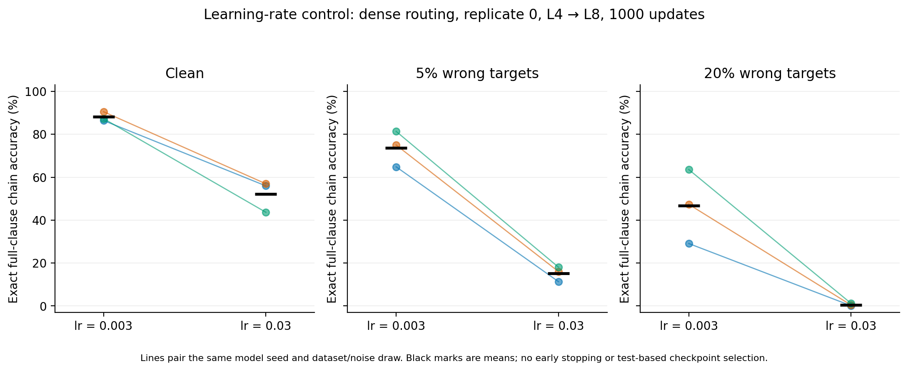
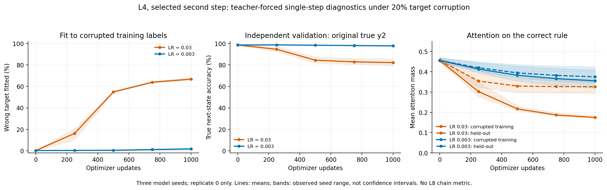
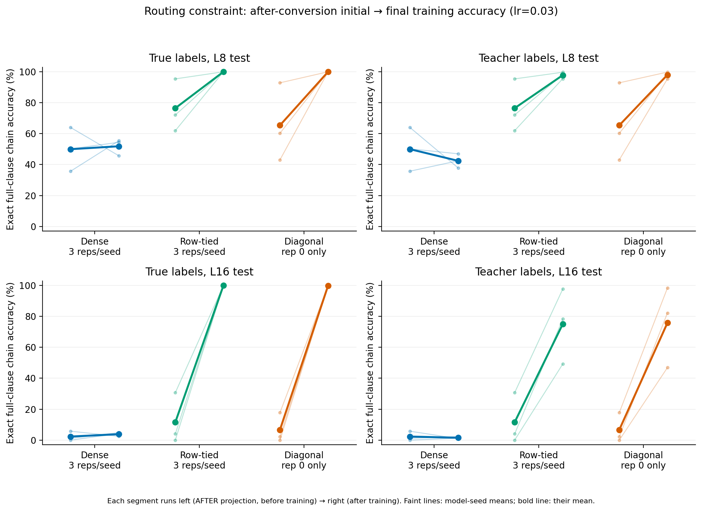
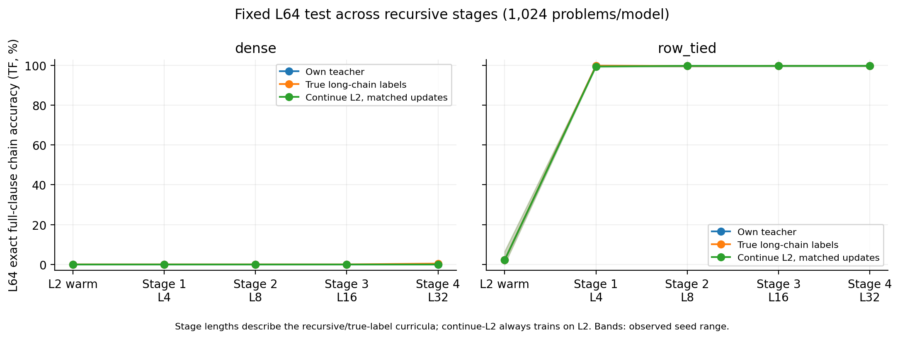

# 第二轮结果：检索参数结构、错误标签记忆与递归长度扩展

日期：2026-11-09（北京时间）。本轮完成87组预设的一次扩展实验、78组预设条件触发的递归/控制实验，以及3组明确标记为后续探索的低学习率教师对照，共168组训练。另对6个含噪训练run的5个检查点做了只读误差动力学诊断。

## 结论先行

有限数据下，稀疏第二步监督的效果同时取决于检索参数结构与优化过程。独立重复确认了局部一致性与局部冲突的区别，但降低学习率能明显缓解冲突标签造成的退化，第一轮不是固定噪声阈值。显式约束变量匹配结构后，真实教师监督和递归自训练可以工作；然而同更新/标签预算的短题继续训练也几乎达到同样的长链成绩，尚不能把成功归因于逐轮增加推理长度的必要性。

## 1. 独立重复与优化敏感性

保持第一轮S5与已准入冻结FFN不变。3个局部模型种子，每个模型独立抽取3个训练/噪声数据集；各处理在同一模型/数据重复内配对。不是9个独立模型，以下先平均模型内重复，再平均三个模型。主终点为L4训练后L8全子句整链正确率：1024题teacher-forced（TF，条件为正确前缀），每一步的五个槽全部正确才算整链成功。另在同面板前128题进行自由greedy生成，将预测的全部五槽反馈给模型，不提供正确历史。除另注外，报告表格均为1024题TF指标。

每组4096道L4训练题，只计算第二步状态值y2的损失；冻结整个FFN，仅训练变量匹配参数，Adam、batch128、1000次更新。truth指任务生成器提供的正确轨迹；teacher指上一轮模型自由生成的完整伪轨迹，学生仍只接受y2监督。

| dense Q，lr=0.03 | L8整链均值 | 三个模型各自的数据重复均值 |
|---|---:|---|
| 干净标签 | 51.84% | 55.40% / 54.39% / 45.74% |
| 5%错误目标 | 14.76% | 11.43% / 14.91% / 17.94% |
| 20%错误目标 | 0.61% | 0.20% / 0.46% / 1.17% |
| 20%错误前缀、原题目标 | 0.47% | 0.20% / 0.46% / 0.75% |
| 20%错误前缀、局部一致目标 | 51.09% | 55.37% / 52.80% / 45.08% |
| 真实教师 | 42.43% | 42.45% / 46.97% / 37.86% |

噪声百分比是请求概率，实际比例记录在每组data-audit。局部一致组用已知动作表生成与污染状态相符的目标，相对于实际输入并无局部标签错误，不能称为承受任意20%错误伪标签。

预先固定的较低学习率对照使用三个模型各自的数据重复0：

| 标签条件 | lr=0.03 | lr=0.003 |
|---|---:|---:|
| 干净 | 52.18% | 88.09% |
| 5%错误目标 | 15.14% | 73.73% |
| 20%错误目标 | 0.55% | 46.68% |

两个学习率使用相同数据、初始化、1000次更新和标签预算。匹配更新数不等于匹配优化进程；尚未检验更长训练或相同收敛程度下的表现。这些结果说明优化敏感性，与低学习率延缓退化的解释一致，不等于已证明收敛后能抗噪。它同时改善干净数据表现，不能把收益全解释为噪声处理。

## 2. 拟合训练污染时，正确规则检索遭到破坏

对20%目标噪声、数据重复0的三个模型，读取初始/250/500/750/1000步；完整训练集4096题与独立验证4096题，诊断固定为L4的第二步value，不是L8整链。

| 1000步诊断，三个模型均值 | lr=0.03 | lr=0.003 |
|---|---:|---:|
| 污染训练样本：错误监督目标拟合率 | 66.77% | 1.73% |
| 污染训练样本：正确规则strict top-1 | 38.22% | 98.41% |
| 独立验证：原题正确y2准确率 | 82.21% | 97.80% |

高学习率下，污染目标CE约3.830→0.943、正确规则注意力约0.456→0.175；未污染训练题仍有99.52%准确率，未见题却退化。这与记忆具体污染关联、同时破坏泛化检索的解释一致。低学习率延缓该过程；尚未排除更长训练后同样退化，也未证明唯一因果路径。

## 3. 参数约束的瞬时收益和后续训练收益分开

dense的两个变量匹配块共有32768个可训练系数；row_tied每行只保留一个对角系数及一个共享非对角背景，共512个；diagonal共256个。这里是系数计数，不是去除softmax不变性后的严格可辨识自由度。

dense原样保留；row_tied转换时保留对角、对非对角取每行均值；diagonal保留对角、非对角置零。先在相同新面板评测转换后模型，再训练。后两种结构显式注入变量相等的先验，同时改变模型容量与优化几何，并非模型从标签自行发现该先验。

| 路由/标签 | L8转换后→训练后 | L16转换后→训练后 |
|---|---:|---:|
| dense / truth | 49.97% → 51.84% | 2.31% → 3.85% |
| dense / teacher | 49.97% → 42.43% | 2.31% → 1.52% |
| row_tied / truth | 76.46% → 100.00% | 11.56% → 99.98% |
| row_tied / teacher | 76.46% → 97.83% | 11.56% → 75.07% |
| diagonal / truth | 65.40% → 100.00% | 6.67% → 99.90% |
| diagonal / teacher | 65.40% → 98.01% | 6.67% → 75.81% |

dense和row_tied是3×3重复，diagonal只有每模型重复0。row_tied真实教师组9/9配对在L8/L16都有训练净提升，但L16三个模型均值仍有明显差异。真实教师的监督y2错误率平均约2.265%，不能把这些结果写成高噪声教师鲁棒性。

低学习率的真实教师对照是在观察优化敏感性后新增的3组探索，不属于原87组：

| 真实教师、仅数据重复0 | L8 | L16 |
|---|---:|---:|
| dense lr=0.03 | 43.49% | 1.69% |
| dense lr=0.003（后续探索） | 81.12% | 17.19% |
| row_tied lr=0.03 | 98.01% | 76.86% |

这里高低学习率严格配对于重复0。低学习率明显改善真实教师训练，但在相同1000次更新下仍未达到row_tied表现；尚未对dense递归全过程比较低学习率。

## 4. 递归成功，但短题继续训练也能成功

为排除转换来源影响，dense与row_tied都从同一个合格局部FFN、Q=0重新开始L2真值second预训练。三个row_tied种子在独立验证L4均达100%，通过预先规定的全seed≥95%门槛。然后所有seed、所有dense/row_tied课程分支完整运行L4→8→16→32，对照分支始终训练L2；未筛选成功checkpoint或中途淘汰失败seed。

三个分支分别为：上一轮模型自己生成完整伪轨迹；使用真值的长链课程；始终继续训练L2真值题。每阶段均4096题、1000次更新、128000个value标签呈现；L2控制不匹配FLOPs，也仍需要新真值标签。

| 最终L64全子句整链（TF，1024题） | L2 warm | 自教师课程至L32 | 真值课程至L32 | 同更新/标签预算继续L2 |
|---|---:|---:|---:|---:|
| dense | 0.00% | 0.00% | 0.36% | 0.00% |
| row_tied | 2.18% | 99.80% | 99.80% | 99.80% |

逐seed终点：

| 路由/分支 | seed0 / seed1 / seed2 |
|---|---|
| dense/self | 0.00% / 0.00% / 0.00% |
| dense/truth | 0.98% / 0.10% / 0.00% |
| dense/continue_L2 | 0.00% / 0.00% / 0.00% |
| row_tied/self | 100.00% / 99.90% / 99.51% |
| row_tied/truth | 100.00% / 99.90% / 99.51% |
| row_tied/continue_L2 | 100.00% / 99.90% / 99.51% |

最终row_tied三分支的TF整链分数逐seed完全相同，均值99.80%；在前128题实际自由生成评测中，三分支、三个seed的L64整链率均为100%。自由生成面板较小，不能把这个100%外推为总体零错误率。

自训练分支在L2 warm之后没有使用新真值来修正或筛选伪标签，这部分流程可行。短题真值继续训练达到同样终点，说明在本设置下逐轮增加长度并非取得这一成绩的必要条件；不能据此否认自训练可能节省新真值标签。应区分标签来源价值与长度课程的独有价值。

递归每轮实际监督y2的错误率均值如下：

| 教师 | L4阶段 | L8阶段 | L16阶段 | L32阶段 |
|---|---:|---:|---:|---:|
| dense | 2.26% | 12.99% | 40.86% | 65.38% |
| row_tied | 0.02% | 0.00% | 0.01% | 0.01% |

row_tied的监督错误极少，且相关前缀/目标近乎局部一致；最后一轮seed2有1/4096个局部冲突目标。该递归成功并非任意错误教师也能稳定的证据。dense的错误反馈逐轮增大，但递归主比较固定lr0.03，不能把失败视为任意优化设置下dense均不可能。

## 5. 可直接核验的注意力几何

在row_tied且前缀正确、变量无重复时，query变量i的正确规则与当前答案总质量精确为

\[m_i(L,t)=\frac{e^{d_{43,i}}+e^{d_{44,i}}}{e^{d_{43,i}}+e^{d_{44,i}}+(L-1)e^{b_{43,i}}+t e^{b_{44,i}}}.\]

t是当前答案之前的旧答案数。由此可计算m≥0.95的最坏位置容量；这个阈值不是准确率保证。模型实际变量词表最多允许L127，超出部分只作为形式上的注意力尺度，不是实验验证过的长度。

容量诊断覆盖全部39个row_tied检查点，公式与小模型直接计算的最大差异为4.44×10⁻¹⁶。从第2阶段起，两种训练方式的所有变量均已满足L127的该注意力质量阈值。最终自训练的形式容量中位数更大，却没有对应的L64准确率优势。这表明增加优化预算本身可能足以改善本模型的长链表现；注意力质量不能替代对局部FFN、错误前缀和完整生成的评测。

## 核验、范围与后续

- 全部训练入口保留原始配置、源码哈希、数据、初始/最终与中间检查点。原第一轮文件未覆盖。
- 66项代码测试通过；误差动力学的111项配对/模型不变检查通过。
- 87组主面板：87/87组，31362项审计通过。
- 78组递归：78/78组，28661项审计通过。
- 3组后续教师LR控制：3/3组，1131项审计通过。
- 审计核验FFN实际逐tensor冻结、初始投影、约束保持、训练数据和噪声重建、评测面板、阶段谱系和预算。现有保存格式缺少最后一个教师答案的四个非value槽，因此无法独立重建完整教师轨迹hash；实际进入训练的inputs/targets均可核验。
- 原定理的特殊FFN、固定偏置、clipping和渐近条件未完整复现；row_tied/diagonal引入额外先验。尚未验证文献新颖性。
- 优先下一步是研究较温和的变量重命名增强或非对角正则，而不是直接绑定参数，检验能否减少污染记忆，同时保留从数据学习检索的自由度。再用持续新样本、固定教师错误类型及更长优化控制区分样本记忆与一般噪声动力学。

## 文件

- [计划](routing-round2-plan-2026-11-09.md)。
- [主面板原始CSV](../figures/routing-round2-2026-11-09/per_run_phase_length.csv)。
- [递归完整数据](../figures/routing-recursive-2026-11-09/summary.json)。
- [注意力容量诊断](../figures/routing-recursive-2026-11-09/capacity/capacity.json)。
- [误差动力学数字](../figures/routing-round2-2026-11-09/error_dynamics_summary.json)。
- [主面板审计](../runs/routing-round2-2026-11-09/audit.json)、[递归审计](../runs/routing-recursive-2026-11-09/audit.json)、[后续LR控制审计](../runs/routing-lr-teacher-2026-11-09/audit.json)。
- 重建脚本：`src/analyze_routing_round2.py`、`src/analyze_routing_recursive.py`、`src/analyze_routing_capacity.py`、`src/plot_routing_error_dynamics.py`、`src/write_routing_round2_report.py`。
