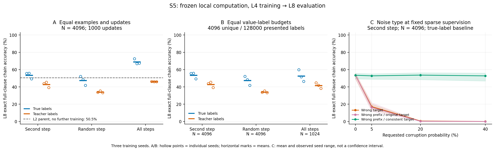
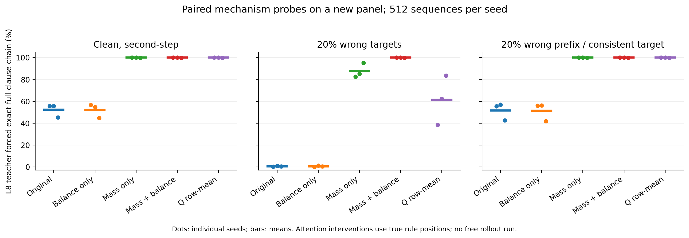

# 稀疏步骤监督与自训练鲁棒性：第一轮实验报告

日期：2026-11-09（北京时间）。本轮正式完成81组训练、18个模型的配对机制诊断；另保留1个未通过局部能力准入的工程pilot。所有训练与诊断已结束。

## 主要发现

1. 在当前有限模型中，第二步监督能学习检索并获得部分长度扩展，但真实教师伪标签没有稳定改善泛化。
2. 4096题条件下全步骤监督的优势，在同时匹配训练集监督位置数和累计标签呈现次数后基本消失；随机单步没有显示优势。
3. 同样的全局目标错误率下，局部转移一致与不一致的污染产生截然不同的结果。5%目标噪声就显著损害外推，但不能把这个数当作普适阈值。
4. 新面板上的oracle注意力干预支持检索混合是重要瓶颈；噪声模型在把总质量固定为0.99后，仍进一步受规则/状态比例影响。Q非对角项的结构是下一步值得研究的候选机制。

## 设置与准入

S5：128个变量、120个动作、5个状态。固定正交one-hot、单头、无残差/LN/V/O投影，只保留两个dense变量匹配Q块。局部计算使用宽512的普通共享GELU MLP，优化器Adam。这是理论启发的有限模型，不是原文特殊FFN及渐近假设的严格实现。与此前端到端双头模型的实验分开报告。

先在32768条L1题目上监督全部五槽，Q固定为0。三个正式种子分别在5000/5000/4500步达到准入：独立L1面板、600个动作/状态组合×16组变量对及L1/4/16/64的oracle检索面板均达到检查标准；本轮对应value与variable实测全对。初始4000步pilot未学充分，保留失败记录，没有进入主实验。

随后冻结整个MLP，仅训练Q。L2阶段三种监督各3个种子；L4全部分支从本seed的L2-second父模型初始化，并使用该共同教师生成标签。attention阶段每组1000次Adam更新、lr0.03；随机位置每题只抽一次。主比较只对value槽计算loss，完整五槽仍作为历史及自由生成反馈。

主要终点预先指定L4训练后的L8全clause整链正确率：每seed在同一独立于训练的1024题面板评测，另有128题真实自由生成及首错分布。下表是三seed均值，逐seed数据和范围保留在JSON/CSV。三seed独立初始化及局部预训练数据；L4题目和噪声抽样共用，不是三个独立噪声数据集重复。

## 1. 稀疏监督、全步骤与预算

| 条件 | 第二步 | 固定随机单步 | 全步骤 |
|---|---:|---:|---:|
| 真值，等题数4096 | 53.45% | 47.33% | 68.88% |
| 教师，等题数4096 | 42.71% | 34.02% | 46.00% |
| 真值，等value标签预算 | 53.45% | 47.33% | 52.54% |
| 教师，等value标签预算 | 42.71% | 34.02% | 41.54% |

未继续训练的共同L2父模型L8均值为 **50.46%**，三个种子为 37.01% / 52.25% / 62.11%。因此教师分支本轮没有稳定收益：不能把“完成了自训练流程”写成“自训练成功延长推理”。干净真值second的三seed是 55.47% / 55.66% / 49.22%。

等标签控制中，second/random使用4096题×1标签，all使用1024题×4标签；batch分别为128与32，因此训练集监督位置数均4096，累计value标签呈现均128000，更新均1000次。题目多样性、可见前缀信息与教师完整轨迹生成成本仍不同，未宣称全部成本相等。

较小样本512题也已完成。L8均值如下：

| 512题 | 第二步 | 固定随机单步 | 全步骤 |
|---|---:|---:|---:|
| 真值 | 57.00% | 47.95% | 48.63% |
| 教师 | 50.68% | 41.63% | 41.99% |

数据量效果并不单调。固定更新次数意味着较小数据集被重复更多次；当前不能据此断言“更多数据有害”。需要结合变量对覆盖、训练/测试损失及优化预算进一步诊断。

## 2. 错误的局部一致性比单一全局错误率更有区分力

以下均固定second监督、4096题、正确变量槽。不同噪声类型共用污染题目与替换随机数；不同噪声比例嵌套。

- target：正确前缀，y2目标改为另一个合法但错误的状态。
- prefix_inconsistent：输入y1错误，目标保留原题正确y2。
- prefix_consistent：输入y1错误，目标同步设为g2(污染y1)。相对原题目标错误，但相对实际输入的局部转移完全一致。

| 请求污染率 | 错误目标 | 错误前缀、原目标 | 错误前缀、局部一致目标 |
|---|---:|---:|---:|
| 0% | 53.45% | 53.45% | 53.45% |
| 5% | 17.19% | 16.28% | 52.77% |
| 20% | 0.59% | 0.29% | 53.61% |
| 40% | 0.03% | 0.00% | 52.73% |

请求5/20/40%的实际污染比例为4.736/19.238/39.038%，均保存在data-audit。prefix_inconsistent的目标相对原题正确，不能称为相同目标错误率；target与prefix_consistent的全局目标错误率匹配。

这个控制支持：只用“伪标签相对原轨迹错误率”不足以刻画训练数据质量，需要同时看给定实际前缀的局部一致性。它**不证明模型耐受40%任意错误伪标签**：一致目标由已知动作表构造，相对于污染输入并没有局部标签错误。全部结果只适用于当前架构、冻结安排、训练预算和学习率，未确定通用临界噪声。

## 3. 配对机制诊断

18个模型覆盖六类训练条件×三seed；每个模型用全新的512题面板，在L8和L16分别做八种干预。保持正确规则与当前答案的总注意力m或二者比例r中的一个不变，改变另一个；其余背景注意力保留内部相对比例。还有原始、重建sham、随机可行转移和两个Q结构控制。

下表为L8全槽teacher-forced整链正确率均值；与主表不同的是评测面板与样本数。

| 模型 | 原始 | 只令r=1/2 | 只令m=0.99 | 同时调整 | Q非对角行均值替换 |
|---|---:|---:|---:|---:|---:|
| 干净second | 52.28% | 52.15% | 99.93% | 99.93% | 99.93% |
| 真实教师second | 41.21% | 41.28% | 99.93% | 99.93% | 99.93% |
| 20%目标噪声 | 0.59% | 0.59% | 87.57% | 99.93% | 61.39% |
| 20%前缀不一致 | 0.52% | 0.85% | 88.15% | 99.93% | 62.76% |
| 20%前缀一致 | 51.69% | 51.43% | 99.93% | 99.93% | 99.93% |

干净模型主要表现为相关信号质量不足：保持原比例，仅提高正确两项总质量就接近全对；只平衡没有改善。目标噪声模型仅提高质量仍有残余错误，再平衡可以恢复，支持总质量与比例存在交互限制；提高总质量本身也会放大绝对权重差，因此不能据此断言训练独立损坏了两个机制。

另一个候选机制是有限数据产生的变量身份相关非对角关联。保留Q对角，把每行非对角值替换为该行均值，干净second的L16诊断从4.88%升到99.28%。但该操作同时把相关注意力质量由约0.766提升到0.915，尚不能分离“去除错误变量关联”与“减轻稀释”。

**解释边界：**注意力干预使用真实规则位置，只是机制诊断，不能报告为无需额外信息的推理方法。此次干预没有运行自由生成，仅报告TF诊断。联合恢复接近预训练时的理想混合，是有用的正对照，不是新的算法定理。Q结构处理也利用了已知变量匹配结构，需新训练/测试控制后再考虑方法贡献。

随机转移因可行性限幅，并非精确等幅对照。干净L8随机实际L1约0.052、联合定向干预约0.235，目标噪声条件约0.140对0.838；不能用随机控制的弱效果证明位置选择是唯一原因。

## 完成、核验与后续

- 正式81组：3个局部预训练、9个L2正对照、36个L4监督/数据量对照、6个等标签控制、27个噪声条件。另保留失败pilot。
- 主实验审计：5058项检查通过，核验真实FFN逐tensor冻结、检查点hash、共同初始化、训练/评测配对及双标签预算。
- 机制审计：18×2×8条件，12621项检查通过，重建sham的正确性/首错数组与原始完全一致，最大logit差7.63e-6。
- `python -m pytest -q tests`：46项全部通过，覆盖因果性、query选择、冻结、噪声语义、预算相关数据统计、评测聚合及干预恢复。报告所有相对链接均已核验，主图及机制图已目视检查。
- 本轮按计划完成一次共同教师扩展；结果尚不支持稳定改善，先完成机制诊断再决定下一轮递归设置。
- 下一轮优先：独立训练/噪声抽样重复；固定预算的噪声学习率/早停控制；用新面板验证Q非对角约束是否能改善真实教师自训练；之后再检验多轮长度扩展。尚未完成新颖性文献核查。

## 可复查产物

- [实验计划](sparse-supervision-plan-2026-11-09.md)。
- [总览PDF](../figures/sparse-supervision-2026-11-09/sparse_overview.pdf)、[总览逐seed数字](../figures/sparse-supervision-2026-11-09/sparse_overview.json)、[完整评测CSV](../figures/sparse-supervision-2026-11-09/per_seed_evaluation.csv)。
- [正式计划与命令](../runs/sparse-supervision-2026-11-09/campaign-plan.json)、[完成记录](../runs/sparse-supervision-2026-11-09/campaign-complete.json)、[主实验审计](../runs/sparse-supervision-2026-11-09/audit.json)、[机制审计](../runs/sparse-supervision-2026-11-09/probes/audit.json)。
- 重新汇总：`python src/analyze_sparse.py`、`python src/plot_sparse_overview.py`、`python src/plot_sparse_mechanism.py`。
- 训练与机制入口：`run_sparse_campaign.py`、`run_sparse_probes.py`；已完成目录会跳过，单run入口拒绝覆盖。
