# 思维链长度泛化实验总报告

**主题：数据结构、路由约束、位置编码与注意力机制**  
**整理日期：2026 年 11 月 11 日（北京时间）**  
**原文：*Transformers Provably Learn Chain-of-Thought Reasoning with Length Generalization*，NeurIPS 2025**

本报告以可视化展示当前工作区中已经完成的实验，包括未达到预期的结果、后续修正和工程试跑。完整数值与设置保留在[数值附录](数值附录.md)，所有新增图提供 PNG 和可导出的 PDF。实验目录主要标记为 `2026-11-09`、`2026-11-10`；目录日期是产物标识，不保证等于北京时间完成日期。此次工作为读取已有产物、重新聚合与撰写报告，没有重新训练模型。

报告以保存的配置、最终评测及阶段报告为依据。Phase C、Phase D、覆盖对照和早期位置编码结果重新从逐运行 JSON 聚合；其他阶段同时参考已完成的专项分析。另附可重建的数据提取脚本、18,304 行评测记录和来源文件 SHA-256 清单。该清单记录本次读取的 JSON，并不替代重新加载所有 checkpoint 的模型审计。

## 摘要

目前最有支持的结论是：**长度泛化取决于局部计算、正确规则排序、相关信息的注意力总量以及规则与状态的混合比例；其中任何一个单独指标都不足以解释全部结果。**

- **结构约束有效，但需要合适的优化预算。** 在固定 1,000 步实验中，软行约束、变量重命名和硬行共享均显著改善 L16；L64 仍不稳定。Phase D 的 2,000 步比较中，dense、软约束 λ=0.1、λ=1 和 hard row_tied 的 L64 完整整链率分别为 **0%、19.74%、44.19%、93.12%**。
- **长度课程不是当前模型成功的必要条件。** 八种子 Phase C 中，hard row_tied 的自教师课程、真值课程、持续短题训练最终 L64 分别为 **99.78%、99.73%、99.84%**。这些结果支持当前协议可学到泛化解，但不构成一般收敛定理。
- **局部一致性比单一“标签错误率”更能刻画数据质量。** 对错误前缀生成与其一致的下一步目标，影响很小；输入与目标局部冲突则明显破坏检索。学习率与初始化会改变噪声实验的结论。
- **“加入位置编码必然失去泛化”不成立。** 位置机制、FFN 预训练与推理权重共同影响结果。旧 FFN 上固定正弦偏置可保持高 L64；重新预训练 FFN 后，连无位置编码基线的原始 L64 也降到 0%，因此不能把所有下降归因于位置编码。
- **注意力干预提供了执行机制的因果证据。** 相对位置模型仅提高正确两项总质量，L64 为 **21.48%**；同时恢复规则—状态平衡则达到 **100%**。这反驳了“只要集中就足够”的单指标解释。
- **部分恢复无需正确规则位置。** 在短链验证集选择参数、锁定后测试的实验中，无位置预训练模型仅锐化注意力即可从 L64 **0%→99.61%**；绝对位置模型通过结构分组达到 **81.93%**。dense 的排序错误无法由这些保持排序的变换修正，仍为 0%。

上述数值默认指 **teacher-forced 完整五槽整链正确率**，不是最终答案率。不同实验的面板、初始化及训练预算不同，不能把跨实验数字当作逐题配对的提升。


**读图约定：**除另注外，纵轴或颜色表示 TF 完整五槽整链正确率（%），越高越好。各图在原章节保留训练与评测设置。只有 Phase A 配对收益图使用 95% bootstrap 区间；Phase D 和无 oracle 推理图展示逐 FFN seed 的实际分散程度。示意图明确标注不属于实测数据。主阶段曲线与 seed 点从保存的 CSV 重算，其余图由已核对、保留两位小数的汇总表绘制。

## 目录

1. [研究问题与原文关系](#1-研究问题与原文关系)
2. [任务、模型、术语与指标](#2-任务模型术语与指标)
3. [实验清单与完成状态](#3-实验清单与完成状态)
4. [端到端复现、温度、上下文与自训练](#4-端到端复现温度上下文与自训练)
5. [稀疏监督与局部一致性](#5-稀疏监督与局部一致性)
6. [独立重复、结构转换与早期递归实验](#6-独立重复结构转换与早期递归实验)
7. [大规模 Phase A/B](#7-大规模-phase-ab)
8. [软约束、重命名及静态覆盖诊断](#8-软约束重命名及静态覆盖诊断)
9. [变量配对覆盖控制](#9-变量配对覆盖控制)
10. [Phase C：八种子长度课程](#10-phase-c八种子长度课程)
11. [Phase D：较长预算结构约束](#11-phase-d较长预算结构约束)
12. [位置编码 v1/v2/v3](#12-位置编码-v1v2v3)
13. [带位置偏置的 FFN 预训练](#13-带位置偏置的-ffn-预训练)
14. [注意力集中与平衡的因果干预](#14-注意力集中与平衡的因果干预)
15. [不提供正确规则位置的推理干预](#15-不提供正确规则位置的推理干预)
16. [理论解释、发现与边界](#16-理论解释发现与边界)
17. [审计、更正、复现与文件索引](#17-审计更正复现与文件索引)

## 1. 研究问题与原文关系

本系列实验围绕四个问题展开：

1. 在什么数据分布、监督结构和参数约束下，训练更容易得到可长度泛化的解？
2. 自训练的收益来自长链课程、额外优化，还是教师标签提供的信息？
3. 绝对、正弦与相对位置信息是否导致位置捷径，进而影响长链推理？
4. 正确规则获得高注意力是泛化的原因，还是与其他机制共同出现的现象？

原文已经在指定分布、架构、初始化、梯度训练和渐近尺度下证明可学习性，而不只是证明“存在一个泛化解”。本项目主要研究这些假设放宽后，在有限数据、普通 GELU FFN 和 Adam 下会发生什么。

必须区分三个层次：**模型能否表达算法、有限训练数据能否识别算法、指定优化过程能否找到算法**。本报告的固定预算实验主要检验后两者的经验表现。没有用有限准确率替代数学收敛证明，也没有严格复现原定理的特殊 FFN、全部固定偏置和 clipping 条件。

原文相关精读与假设分析见 [论文精读](../../notes/paper-review-zh.md) 和 [收敛条件备忘录](../../notes/convergence-conditions-2026-11-10.md)。

## 2. 任务、模型、术语与指标

### 2.1 数据与状态追踪任务

题目由若干规则、初始状态和逐步答案组成。每步执行

\[
y_t=g_t(y_{t-1}),
\]

其中变量身份决定下一条规则的位置，动作决定状态如何变化。规则和答案使用明确的五槽 clause 格式；这是任务结构先验，不是未经组织的自然语言文本。链上变量无放回抽样，通常保证正确下一条规则唯一。

| 任务 | 状态数 | 动作 token 数 | 实际动作结构 |
|---|---:|---:|---|
| C6 | 6 | 6 | 六元循环作用 |
| C5 | 5 | 5 | 五元循环作用 |
| S5 | 5 | 120 | 五个状态的全部置换 |
| aliasC5 | 5 | 120 | 五种循环变换，每种 24 个 token 别名 |

aliasC5 与 S5 的词表大小相同，但实际函数结构不同，因此可用来检验“只是动作 token 多，所以难学”的解释。

### 2.2 两类模型不能直接混合比较

原文理论部分采用第二类的基本骨架；附录 A 的实证模型明确为双头。我们第二类使用普通 GELU FFN 与 Adam，soft / row_tied 则是额外拓展，不能等同于原定理全部条件的严格复现。

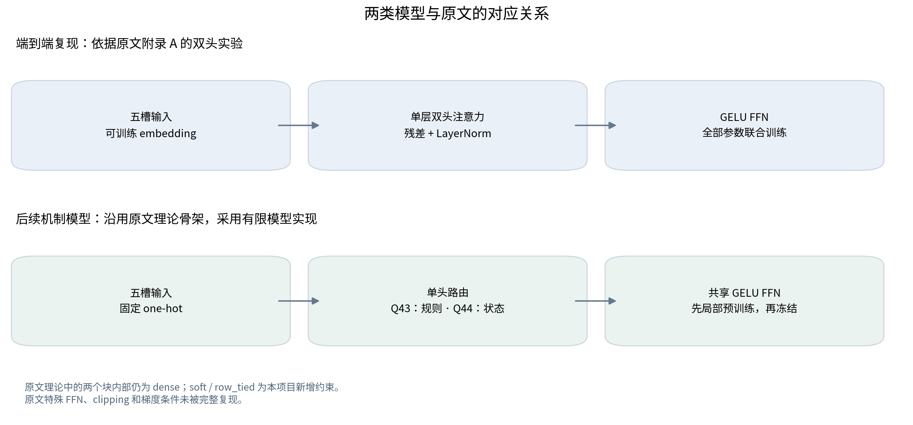

结构图用于说明架构与训练流程；完整维度和配置见[附表 02](数值附录.md#表-02)。

128 个变量、链变量不重复时，可用链长受词表限制；形式上的超长容量计算不等于实际验证了任意长度。

### 2.3 dense、软约束、hard row_tied 到底是什么

后续模型有两块矩阵：`Q43` 根据 query 的第 4 槽变量匹配规则的第 3 槽；`Q44` 匹配答案的第 4 槽。设每块为 \(n\times n\)，\(n=128\)。

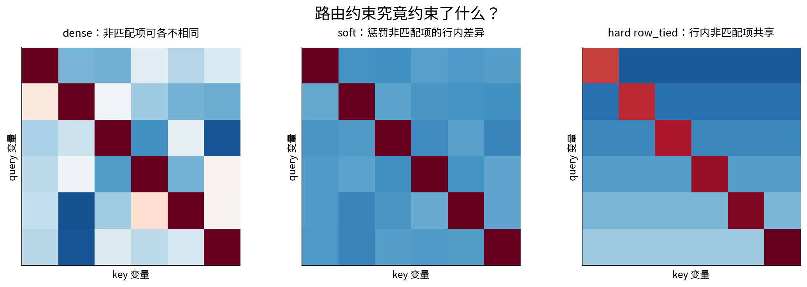

示意矩阵，不是训练得到的 Q；三个面板使用相同色阶。hard 同一行的非对角项同色，不同行可以有不同参数。dense / soft / hard 的两块 Q 参数数分别为 32,768 / 32,768 / 512；diagonal 为 256。rename 改变变量曝光，Q-L2 惩罚全部 Q 元素。完整定义见[附表 03](数值附录.md#表-03)。

软约束的实际归一化为

\[
\mathcal L=\mathcal L_{\mathrm{CE}}+\lambda R(Q),\qquad
R(Q)=\frac12\sum_{b\in\{43,44\}}\frac1{n(n-1)}
\sum_i\sum_{j\ne i}(Q^b_{ij}-\bar Q^b_{i,\mathrm{off}})^2.
\]

λ 越大，偏离行共享结构的代价越高；但 λ 大不保证正确匹配分数足够高，也不保证规则和状态权重平衡。硬共享改变了参数化和 Adam 状态，不能把它简单等同于 λ→∞ 的软约束训练轨迹。

row_tied 仍允许不同 query 行参数不同，**不等于完整变量置换不变性**。对所有变量置换都不变的固定路由核须具有 \(aI+b\mathbf1\mathbf1^\top\) 的形式；本系列尚未完成这种全局共享核及留出 query ID 的训练对照。

### 2.4 指标与统计单位

| 指标 | 定义 | 用途 |
|---|---|---|
| TF 完整整链 | 每一步使用正确历史，所有步骤、全部五槽都预测正确 | 本报告默认主指标 |
| TF value 整链 | 所有步骤的状态值正确，不要求其他槽都正确 | 辅助指标，可能高于完整整链 |
| greedy 完整整链 | 把模型生成的全部五槽反馈，整条生成轨迹全对 | 实际自由生成验证 |
| greedy 最终 value | 只判断自由生成最后一个状态值 | 不代表中间推理轨迹正确 |
| 正确规则 strict top-1 | 正确规则分数严格高于其他规则；并列不计成功 | 检索排序诊断 |
| 相关质量 \(m\) | 正确规则和当前状态位置的注意力之和 | 集中程度，不等同于低熵 |
| 规则占比 \(r\) | 正确规则注意力 / 两个正确位置的总质量 | 必要信息之间的平衡 |

在相同样本、确定性解码且前向实现一致时，TF 完整整链全对与 greedy 完整轨迹全对具有相同成功事件；但本项目两类评测常用不同样本数，所以图中均值不必相同。TF value-only 没有这种对应关系。

统计通常先在同一 FFN seed 内平均 data replicate，再跨 FFN seed 等权平均。4 seeds×2 repeats 是 4 个局部模型与 8 个配对运行，不能称为 8 个独立 FFN。不同 checkpoint、单个 query 和同一模型下的多个干预不算新的独立模型重复。除特别注明，图表单位均为 **百分比（%）**；逐种子范围不是置信区间。

## 3. 实验清单与完成状态

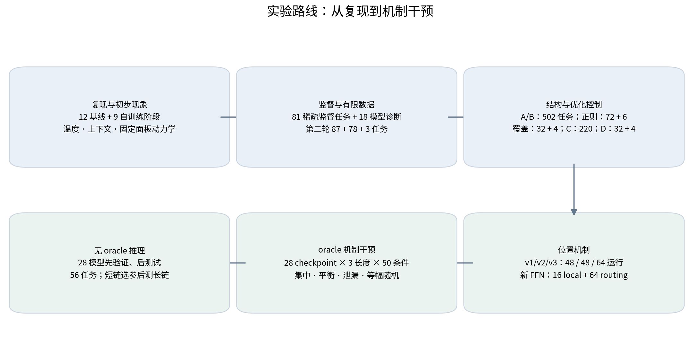

各框是研究问题的推进关系，面积不代表任务量。训练阶段、评测任务和 smoke 不属于同一统计单位；v2/v3 重合条件不能算独立复制。完整完成清单见[附表 05](数值附录.md#表-05)。

此处“任务”包括训练阶段、评测任务或工程 smoke，不能相加后称为独立实验样本量。v2/v3 重合结果不能当作独立复制。工程失败记录、初始 checkpoint 和中间阶段不进入正式终点均值。

## 4. 端到端复现、温度、上下文与自训练

### 4.1 实验设计与设置

对 C6/S5/C5/aliasC5 各训练 3 seeds。训练 L5，固定 8,192 题，300 epochs，每 epoch 遍历一次固定题库；batch 128，Adam lr=1e−4，无 dropout、无 weight decay，五槽平均交叉熵。缺失于原文的超参数由本项目补全，因此是独立实现的定性复现检验。

评测 L5/10/20/40/80/160，每长度 1,024 TF 题、512 greedy 题。推理 logits 乘数 α∈{0.5,1,2,4}，同任务、同长度共用面板。温度扫描是探索性分析，未把测试面板最优 α 当作预先选择的方法性能。

### 4.2 L160 温度干预

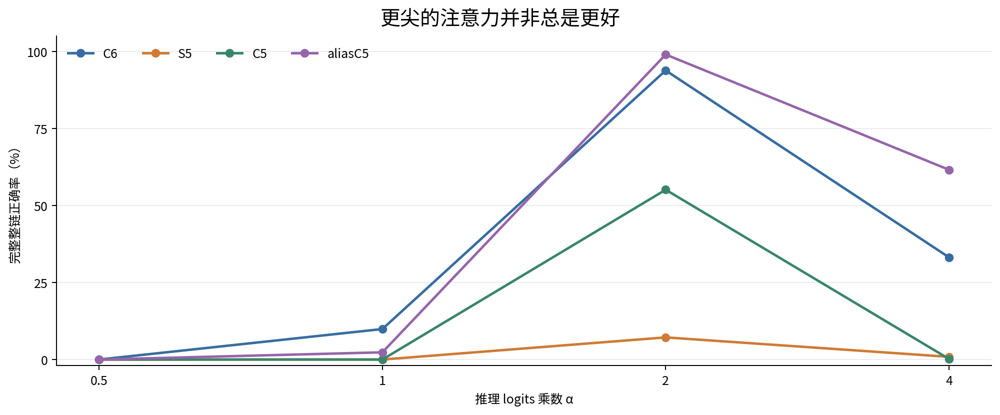

L160，3 seeds 的均值。α=2 后继续增大至 4，多个任务退化；这是测试面板上的探索性扫描。

[完整数值：附表 06](数值附录.md#表-06)。

默认 α=1 未完整复现 C6 在极长链上的高成功率；α=2 能显著改善多个任务，但 α=4 又退化，说明注意力变尖并非单调有益。

aliasC5 与 S5 的动作词表同为 120；L40、α=1 分别为 99.35% 与 53.68%，L160、α=2 分别为 98.99% 与 7.19%。这排除了“词表大小足以解释难度”的简单说法，但没有隔离动作共享、局部表示、曝光频率与优化之间的作用。

### 4.3 固定推理深度、增加无关上下文

设计：推理链固定 L5，加入 0/5/20/80/160 条离路径规则；比较随机动作、只对第一步兼容或不兼容的动作。每面板 512 TF、128 greedy，α=1/2/4。干扰使用离路径的重复变量，属于原始无重复变量训练分布之外的明确 OOD。

下图展示 α=1、随机干扰的完整整链率：

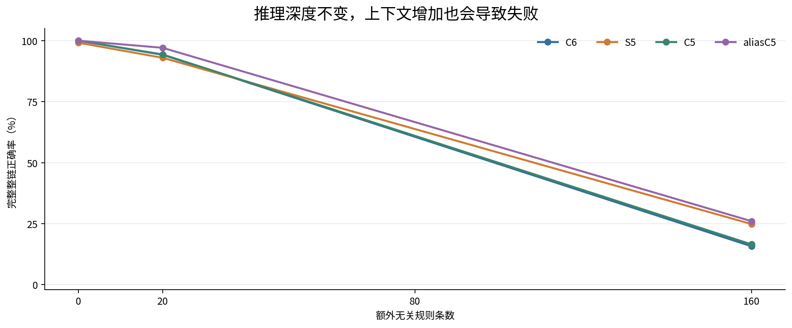

L5 固定，α=1，随机干扰；显示报告中的 0/20/160 三个条件。干扰包含重复离路径变量，属于明确的 OOD。

[完整数值：附表 07](数值附录.md#表-07)。

+160 条时，第一步兼容/不兼容条件分别为：C6 14.58/15.49，S5 22.66/21.55，C5 13.67/14.91，aliasC5 20.64/26.11。没有表现出简单的“兼容必然更好”排序。上下文体积本身就能破坏短推理，但这些 OOD 干扰不能单独证明纯 softmax 稀释是唯一原因。

### 4.4 端到端 S5 递归自训练

从 L5 基线出发，按 L10→20→40 生成并训练。每轮教师完整自由生成 8,192 条伪轨迹，全部保留；真值只做事后审计，不筛选、不修正标签。每阶段训练 300 epochs，batch 128、Adam lr=1e−4，重置优化器。

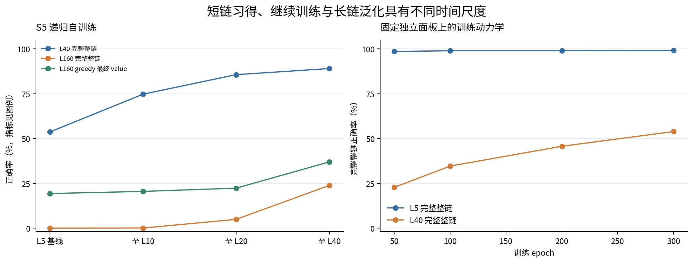

左图区分完整整链与最终 value，三种子均值；早期自训练尚无等预算短链控制。右图 L5/L40 各 256 题，跨 checkpoint 使用相同题目。

[完整数值：附表 08](数值附录.md#表-08)。

最终 L160 三个 seed 分别为 8.20/63.18/0.20%，差异很大。教师伪轨迹全对率随阶段从约 96–99% 下降到 71.70–97.38%。由于此时尚无等预算短链继续训练控制，不能把收益全归因于自训练或长度课程。

### 4.5 固定面板训练动力学

S5 在 L5/L40 各 256 题固定面板上：

[完整数值：附表 09](数值附录.md#表-09)。

短链接近饱和后，长链仍改善，支持区分局部习得与外推形成的时间尺度；当前证据不足以把它命名为 grokking。

来源：[复现与恢复报告](../../notes/recovered-results-2026-11-09.md)，`runs/base_*`、`runs/self_*`、各模型 `context/evaluation.json`。

## 5. 稀疏监督与局部一致性

### 5.1 设计与设置

采用 S5 稀疏模型。先以 L1 的 32,768 题训练 FFN，batch 256，Adam lr=.001，Q=0；正式 seed 0/1/2 在 5,000/5,000/4,500 步通过局部准入。检查包括独立 L1、600 个动作—状态组合×16 组变量对，以及长上下文 oracle 各半混合的 value/variable 正确率≥99.95%。初始 4,000 步 pilot 未达标，未进入正式主实验。

冻结 FFN 后训练 Q：L2 三种监督；L4 各分支均从对应 seed 的 L2-second 模型初始化，使用同一个共同教师。每分支 1,000 次 Adam 更新，lr=.03，只对 value 槽计算损失。

- **second**：每题只监督第二步。
- **random**：每题固定随机抽一个步骤，训练时不重抽。
- **all**：监督全部步骤。

正式 81 任务 = 3 local + 9 L2 + 36 L4 题量/监督对照 + 6 等标签控制 + 27 噪声任务。三种子共享该阶段训练/噪声抽样，独立性主要来自初始化和局部预训练；后续第二轮才加入独立路由数据重复。

### 5.2 监督稀疏性与标签预算

主终点 L8，1,024 TF、128 greedy。下图为 TF 完整整链：

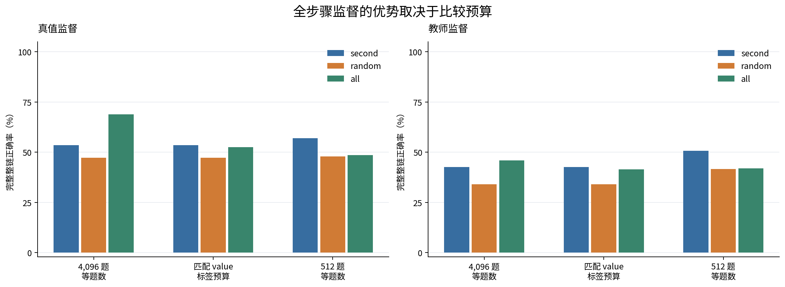

L8，3 seeds；三组柱分别表示三个独立预算协议。等标签条件下 all 的优势基本消失。

[完整数值：附表 10](数值附录.md#表-10)。

等预算时 all 使用 1,024 题×4 标签、batch 32；second/random 使用 4,096 题×1 标签、batch 128；均为 1,000 更新与 128,000 次 value 标签呈现。题目多样性、前缀信息与教师生成成本仍不同。

共同 L2 父模型 L8 为 50.46%；教师训练没有稳定超过该基线。全步骤在等题数下的优势，在匹配监督标签预算后基本消失。512 题不总差于 4,096 题，不能据此宣称更多数据有害，因为固定更新数改变了重复曝光次数。

### 5.3 三种污染的定义与结果

固定 second、4,096 题、变量槽正确。

- target：正确前缀，但第二步目标替换为错误状态。
- prefix_inconsistent：前缀状态错误，仍要求输出原题正确目标。
- prefix_consistent：前缀状态错误，目标同步改为动作作用在该错误状态上的结果。

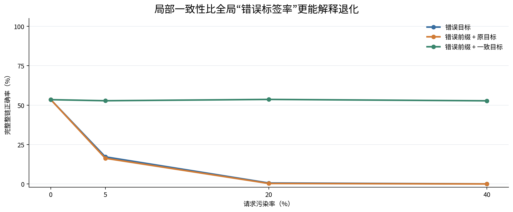

L8，固定 second 监督。局部一致组对实际输入没有错误转移标签，因此不能解释为可承受 40% 任意标签噪声。

[完整数值：附表 11](数值附录.md#表-11)。

实际污染比例分别为 4.736/19.238/39.038%。target 与 prefix_consistent 相对原轨迹的目标错误率匹配，但后者对实际输入没有局部标签错误。因此结果支持检查局部一致性，**不表示模型能承受 40% 任意错误伪标签**。

### 5.4 第一轮注意力与 Q 投影诊断

18 个模型，L8/L16 各 512 条新题，8 种干预；全部使用真实前缀，正确规则位置由评测器提供。

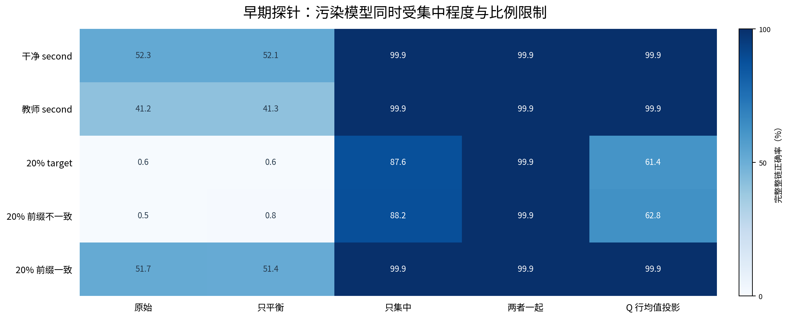

L8 完整整链，18 个模型中的主要条件组；使用 oracle 正确规则位置。旧随机对照有幅度截断，不用于特异性归因。

[完整数值：附表 12](数值附录.md#表-12)。

干净模型的 L16 经非对角行均值替换从 4.88%→99.28%，但相关质量同时从约 .766→.915，未隔离身份关联与质量改善。此轮随机对照受到可行性限幅，不是精确等幅，不能据此建立定向扰动特异性；第 14 节对此做了补充。

来源：[稀疏监督报告](../../notes/sparse-supervision-results-2026-11-09.md)。

## 6. 独立重复、结构转换与早期递归实验

### 6.1 独立数据重复与学习率

沿用三个合格 FFN，每个 seed 独立抽 3 份路由训练/噪声数据。L4、4,096 题、第二步 value、1,000 更新、batch 128；默认从 L2 路由父模型初始化。各处理在 seed/repeat 内配对。

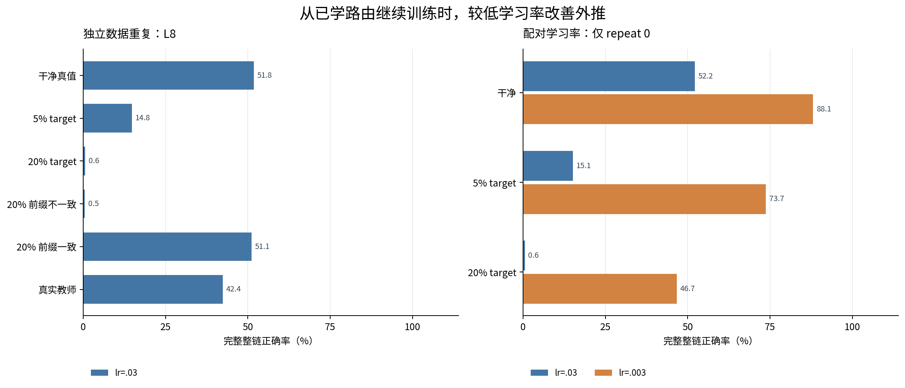

左图 3 FFN seeds × 3 数据 repeats；右图只用每 seed 的 repeat 0。相同更新次数不代表相同优化进程。

[完整数值：附表 13](数值附录.md#表-13)。

每个模型的 repeat 0 另做 lr=.003 配对控制：

[完整数值：附表 14](数值附录.md#表-14)。

低学习率在此初始化和固定预算下明显改善结果；不能据此假定从 Q=0 开始也有同样排序。

### 6.2 污染记忆的训练过程

6 个含噪运行、每个读取 0/250/500/750/1,000 步 checkpoint，完整训练集与独立验证各 4,096 题。诊断 L4 第二步，不能与 L8 整链数字混用。

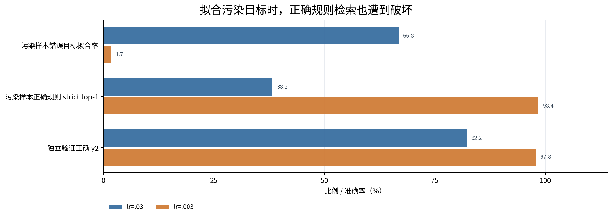

L4 第二步诊断，20% target 污染，1,000 步；三种子均值。第一行越高意味着错误标签记忆越强，并非模型更好。

[完整数值：附表 15](数值附录.md#表-15)。

高学习率拟合污染目标的同时，正确规则注意力下降，支持“记忆具体污染关联会破坏检索”的解释；未证明更低学习率在充分长训练后仍抗噪。

### 6.3 结构转换的即时收益与继续训练收益

从同一 dense 父模型转换：row_tied 保留对角、非对角取行均值；diagonal 保留对角、非对角置零。先评估转换，再训练。dense/row_tied 为 3×3 重复，diagonal 为每 seed 的 repeat 0。

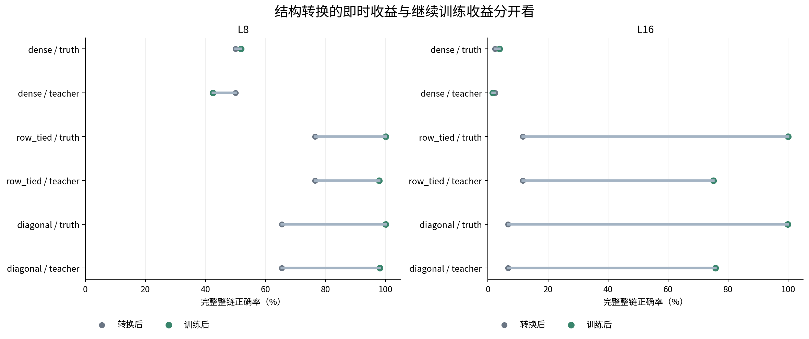

每段线从转换后连接到训练后；dense/row_tied 为 3×3 重复，diagonal 仅每 seed 的 repeat 0。

[完整数值：附表 16](数值附录.md#表-16)。

这既包含结构投影的即时影响，也包含新参数化下的优化收益。教师监督 y2 的错误率仅约 2.265%，不能推广为高噪声鲁棒性。

观察到学习率敏感性后，额外 3 个教师 dense、lr=.003 的探索运行取得 L8/L16=81.12/17.19%；其配对 lr=.03 为 43.49/1.69%，row_tied lr=.03 为 98.01/76.86%。新增运行明确属于后续探索。

### 6.4 三种子的递归与短题控制

重新从同一 local FFN、Q=0 开始，dense/row_tied 各做 L2 真值 warmup；row_tied 全种子独立 L4 验证≥95%后，全部分支运行 L4→8→16→32。每阶段 4,096 题、1,000 更新、128,000 次 value 标签呈现；持续 L2 分支始终训练新 L2 真值题。

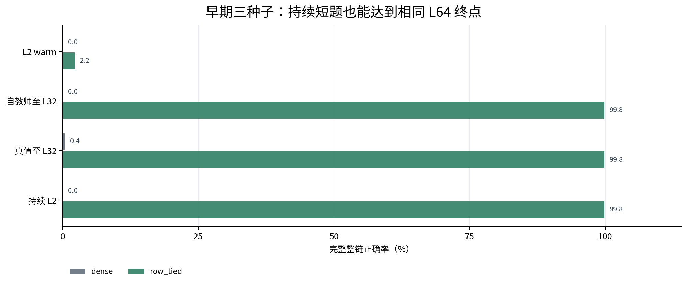

各组柱对应不同训练方案。三种子均值，终点比较匹配更新与 value 标签呈现，不匹配 FLOPs。

[完整数值：附表 17](数值附录.md#表-17)。

row_tied 最后三分支的 seed 终点均为 100/99.90/99.51%；小面板 greedy 各为 100%。自教师四阶段 y2 错误率约 .02/.00/.01/.01%，dense 则为 2.26/12.99/40.86/65.38%。

递归流程可行，但教师几乎无错。持续短题也达到同样终点，说明该设置的成功不要求增长训练长度；自训练在 warmup 后不需新真值标签的价值仍然存在。各分支匹配更新与标签呈现，不匹配 FLOPs。

额外对 39 个 row_tied checkpoint 验证注意力质量公式，与直接计算最大差为 4.44×10⁻¹⁶。m≥.95 的形式容量不是准确率保证。

来源：[第二轮报告](../../notes/routing-round2-results-2026-11-09.md)。

## 7. 大规模 Phase A/B

### 7.1 设计变化

A/B 共 502 个完成任务，包括 480 个正式路由运行。使用 8 个 FFN seeds；学生全部从 local FFN 的 **Q=0** 开始。teacher 标签来自同 seed 的 L2 warmup，而学生不继承该 warmup 的 Q。这个初始化变化使其与第 6 节不可直接比较学习率优劣。

统一 L4、4,096 题、1,000 Adam 更新、batch 128、第二步 value；每长度 1,024 TF、128 greedy，另有 512 validation。

### 7.2 Phase A：结构与标签来源，192 组

8 seeds×3 数据 repeats×2 路由×4 标签条件，lr=.03。

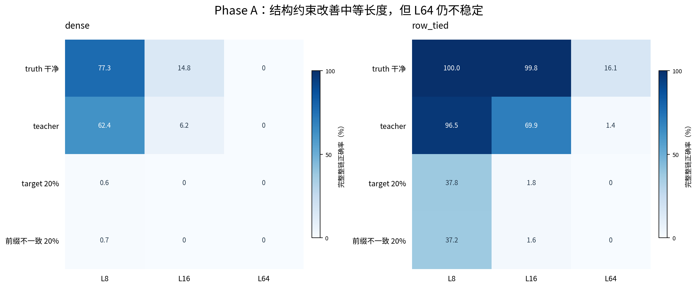

8 FFN seeds × 3 数据 repeats；学生从 Q=0 开始。各格为完整整链百分比，不能把 24 配对当成 24 个独立 FFN。

[完整数值：附表 18](数值附录.md#表-18)。

四种标签条件的 24 个配对均表现为 row_tied 的 L8 更高。分层 bootstrap 先抽 8 个模型 seeds，再抽 seed 内 repeats，平均增益及 95% 区间：

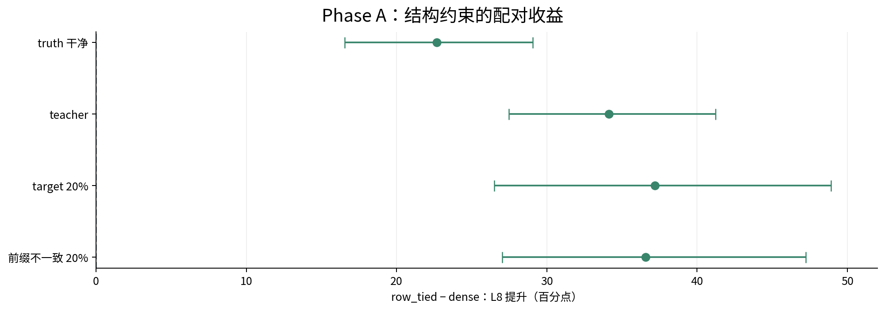

点为平均差值，误差线为 95% 分层 bootstrap 区间；先抽 FFN seeds，再抽 seed 内数据 repeats。

[完整数值：附表 19](数值附录.md#表-19)。

干净 row_tied 的八个 seed L64 均值为 0/.20/73.70/1.76/0/32.78/0/19.95%。高 L16 不代表稳定 L64，成功仍集中在少数 seeds。

### 7.3 Phase B：学习率与噪声，288 组

8 seeds、repeat 0、dense/row_tied、lr=.003/.01/.03、6 种条件：干净、target 5/20/40%、前缀不一致 20%、前缀一致 20%。完整 L8/L16/L64 表见 [附表 B](Phase-B完整结果.md)。

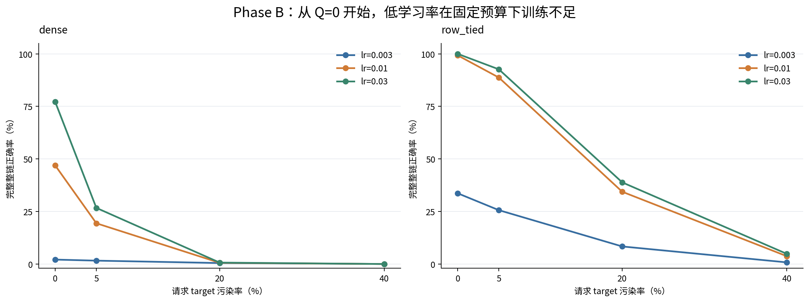

L8，8 seeds，1,000 更新。图中为 target 剂量曲线；前缀一致/不一致对照和 L16/L64 全部数字保留在附录。

[完整数值：附表 20](数值附录.md#表-20)。

从 Q=0 开始、固定 1,000 步时，低学习率明显训练不足，.03 最强；这与从已学路由继续训练时的低学习率优势并不矛盾。lr=.03 的 row_tied 干净 L64 为 15.39%，局部一致组为 16.00%，target 5% 已降至 .12%，20/40% 为 0%。不存在由本实验确立的普适“5% 噪声阈值”。

来源：[A/B 专项报告](../../notes/large-scale-results-2026-11-10.md)。

## 8. 软约束、重命名及静态覆盖诊断

### 8.1 设计与设置

4 个 local FFN seeds×2 独立数据 repeats×9 treatments=72 正式任务，另 6 smoke。从 Q=0 开始，L4、4,096 题、干净第二步 value，1,000 更新、batch 128、lr=.03。每 250 步记录验证、CE、正则项、Q 残差与匹配分数差；最终 1,024 TF、128 greedy。

### 8.2 正则与数据增强结果

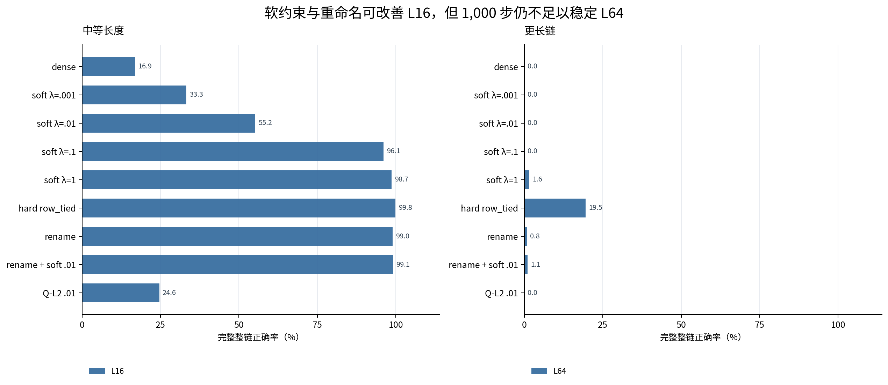

4 FFN seeds × 2 数据 repeats；两图使用相同 0–100% 横轴。hard row_tied 的 L64 成功主要集中于少数 seed。

[完整数值：附表 21](数值附录.md#表-21)。

硬共享不是 L16 高准确率的唯一途径。更弱的软约束或变量重命名也有效；但在这个预算下都没有稳定 L64。hard row_tied 四个 seed L64 为 0/.34/75.34/2.44%，明显不均衡。

### 8.3 参数与覆盖分析

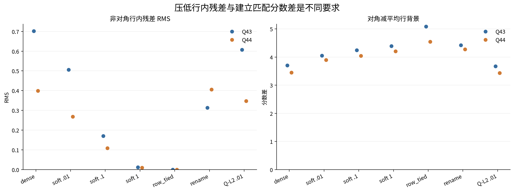

4 seeds 内先平均 repeats，再跨 seeds 平均；各处理是离散协议。平均分数差不等于最差竞争规则 margin。

[完整数值：附表 22](数值附录.md#表-22)。

这里的分数差是平均对角减平均非对角，不是最差竞争规则的 margin。残差小也可能对应 Q=0 或两类目标失衡，因此它不能单独保证泛化。

静态训练输入覆盖全部 query ID，但只覆盖 Q43/Q44 非对角配对的 **53.26%/22.26%**。dense 与 Q-L2 未直接曝光的矩阵项保持精确零；soft/hard 通过参数耦合改变未曝光项。例如 soft1 的 Q43 已见/未见非对角均值约 −.896/−.900，hard 为 −2.624/−2.616。

这里“已见”指进入受监督 query 的可见计算路径，不保证数值梯度非零。rename 的静态模板覆盖率不能代表在线增强后的曝光。该诊断提出了覆盖候选解释，下一节直接操纵覆盖。

来源：[正则报告](../../notes/convergence-followup-results-2026-11-10.md)、[配对覆盖诊断](../../notes/convergence-pair-coverage-2026-11-10.md)。

## 9. 变量配对覆盖控制

### 9.1 设计与设置

4 seeds×2 repeats×均匀/平衡曝光×dense/row_tied=32 正式任务，另 4 smoke。沿用相同 local FFN，从 Q=0 开始；L4、4,096 题、second 真值、1,000 更新、batch 128、lr=.03。TF 1,024、greedy 128。

平衡方案使监督 query ID 循环覆盖，并对可见不匹配 source 使用不同循环偏移，再随机补全链变量；动作和初始状态保持均匀抽样。每个 query ID 出现 32 次。它改变了变量链分布与配对曝光，**不表示全部 128×127 个非匹配配对都已覆盖，也不匹配所有高阶统计量**。

### 9.2 结果与分析

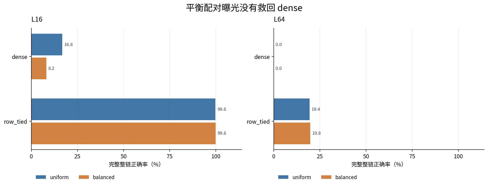

4 seeds × 2 repeats；配对曝光方案改变变量链分布，不表示全部非匹配变量对都被覆盖。

[完整数值：附表 23](数值附录.md#表-23)。

该平衡方案没有救回 dense，L8/L16 反而更低；row_tied 几乎不变。这否定了“只要按当前方案平衡曝光就足以得到泛化”的说法，但不能否定所有覆盖设计或证明覆盖不重要。其余可能因素仍包括背景压低程度、最差竞争项、两目标比例及 Adam 优化几何。

本节从保存的 32 个正式 `evaluation.json` 重新聚合；逐运行状态全部完整。原始清单：[coverage campaign](../../runs/pair-coverage-control-2026-11-10/campaign-plan.json)。

## 10. Phase C：八种子长度课程

### 10.1 设计与设置

使用 8 个 local FFN seeds。dense 与 row_tied 各自从 Q=0 做 L2 warmup，再分为自教师、真值课程、持续 L2 三分支。课程长度 L4→8→16→32；每阶段 4,096 新题、1,000 更新、batch 128、lr=.03、仅第二步 value。自教师标签来自该分支上一阶段 checkpoint；不以真值修正或筛选。

row_tied 的全部 seeds 通过独立 L4 验证≥95%的 warmup 门槛后，才启动课程。共 12 smoke+16 warmup+192 阶段=220 个完成任务。最终比较必须只取 **stage4**，不能把四个课程阶段平均为“终点”。TF 1,024、greedy 128；分支匹配更新/标签呈现，不匹配 FLOPs。self 与 truth 的数据 seed 设置并非完全相同，因此不能宣称两分支训练题逐条配对。

### 10.2 最终结果

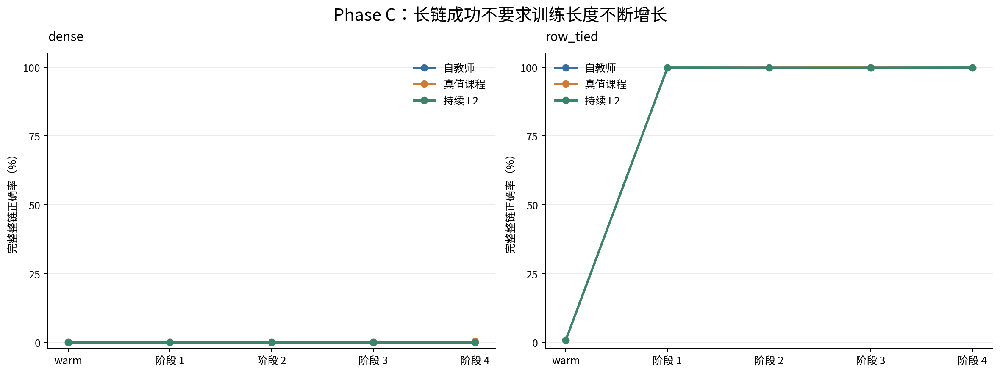

纵轴始终为独立 L64 测试成绩；8 seeds，原始 CSV 重算。课程分支依次训练 L4/8/16/32，持续 L2 分支每阶段始终训练 L2。终点只取阶段 4，不平均中间阶段。

[完整数值：附表 24](数值附录.md#表-24)。

row_tied warmup 的 L64 仅 .87%；最终三分支均接近 100%。八个 seeds 的 L64 范围分别为：自教师 98.93–100%，真值课程 98.63–100%，持续 L2 99.12–100%。

### 10.3 结论

八种子复制支持第 6 节的现象：**结构约束加上足够的优化，可以在这些有限模型中产生稳定的 L64 泛化；增长训练长度不是必要条件。** 三分支的细小均值差异不应被解读为明确优劣。dense 真值课程改善了 L8/L16，但几乎没有 L64，dense 自教师则发生严重退化。

原始清单：[Phase C](../../runs/phase-c-length-curriculum-2026-11-10/campaign-plan.json)，本次重算数据：[aggregates.json](aggregates.json)。

## 11. Phase D：较长预算结构约束

### 11.1 设计与设置

4 seeds×2 独立数据 repeats×4 处理=32 正式运行，另 4 smoke。统一 local FFN、Q=0、L4、4,096 题、干净 second、batch 128、Adam lr=.03，训练 **2,000 步**。比较 dense、soft λ=.1、soft λ=1、hard row_tied；各处理在 seed/repeat 内配对。TF 1,024、greedy 128。

这不是最初大规模草案中的噪声/diagonal 转换设计，而是后来固定并实际执行的“较长预算结构约束”设计，应以实际 manifest 为准。与第 8 节 1,000 步实验的数据和评测 seeds 不同，因此跨章节差异不是单变量预算效应估计。

### 11.2 完整整链结果

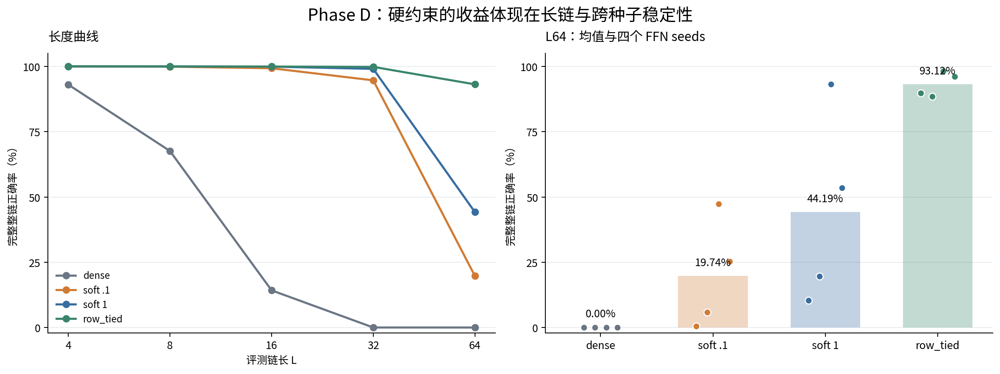

4 seeds × 2 repeats，2,000 更新。右图每个点先平均该 seed 的两个数据 repeats；点是独立 FFN seed，不是置信区间。数据从原始 CSV 重算。

[完整数值：附表 25](数值附录.md#表-25)。

[完整数值：附表 26](数值附录.md#表-26)。

逐 seed 数字先平均两个数据 repeats。soft .1 的 **value-only L64 为 19.85%**，完整五槽为 **19.74%**；本报告统一使用后者。

### 11.3 分析

在相同 2,000 步协议下，hard row_tied 显著优于 dense 和两档软约束，并在全部 seeds 获得较高 L64；soft λ=1 仍有很大的 seed 差异。它支持结构约束的重要性，但没有证明硬共享是唯一有效方法，也没有证明无限训练下 dense 永远失败。

原始清单：[Phase D](../../runs/phase-d-structural-2026-11-10/campaign-plan.json)。

## 12. 位置编码 v1/v2/v3

### 12.1 实际实现与实验意图

这些实验在已训练的无位置 FFN 上加入位置分数，冻结 FFN，再训练路由。四种模式为：

| 模式 | attention 分数中的位置项 | 是否可学习 |
|---|---|---|
| none | 0 | 无 |
| learned_abs | \(p_q^\top p_k/\sqrt{32}\) | 是，位置表 |
| sinusoidal | 固定正弦位置表的同类点积 | 否 |
| relative | \(b(q-k)\) | 是，距离表 |

按 **clause 位置** 索引，位置表上限 257、绝对位置维度 32；learned_abs/relative 初始随机尺度 .02。这里是 **score-only 位置偏置**：位置向量没有直接加到 token embedding、value 或 FFN 输入向量。FFN 只间接看到位置权重改变后的混合输入，因此不应写成标准 Transformer 的加性 PE、RoPE 或 ALiBi 实验。

统一 4 seeds×2 标称 repeats×dense/row_tied，L4、4,096 题、2,000 更新、batch 128、lr=.03、second 真值、TF 1,024、greedy 128。v1/v2 为三种模式，v3 加 relative。

### 12.2 必须保留的设计缺陷

1. **v1 的全部条件使用同一个 data seed**；虽然模型 seed/repeat 字段存在，两个 repeat 不能当成独立数据重复。
2. v2 使用独立 data/noise seeds，修复上述问题；v3 在此基础上增加 relative。
3. **三版的 dense 可学习位置参数未在路由阶段训练，row_tied 中则可训练。** 因此跨路由的 PE 效果比较存在冻结策略混杂。把“dense learned_abs”解释为与 row_tied 一样训练了绝对位置表是错误的。
4. 这些目录的最终评测没有保存独立 `shuffled_evaluations`。原计划写了规则打乱，但不能把计划当成已完成结果；正式打乱对照在第 13 节实现。
5. v2/v3 的同条件数值重合，不能将它们视为新增独立证据。

### 12.3 三版结果保留与 v3 完整比较

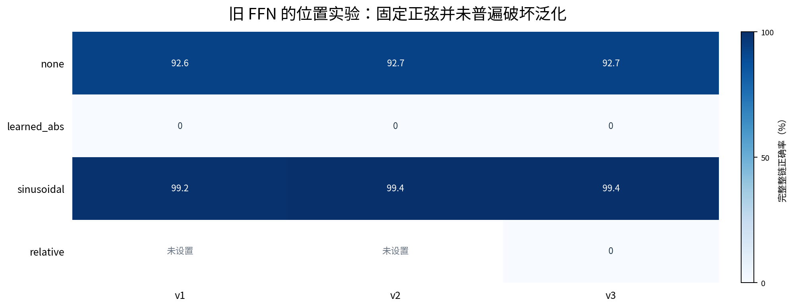

row_tied，L64 完整整链（%）。v1 数据重复不独立；v2/v3 重合条件不能当作独立复制。各版本 dense 与 row_tied 的可学习位置参数冻结策略不同。

[完整数值：附表 28](数值附录.md#表-28)。

v3 各模式的 TF 结果如下：

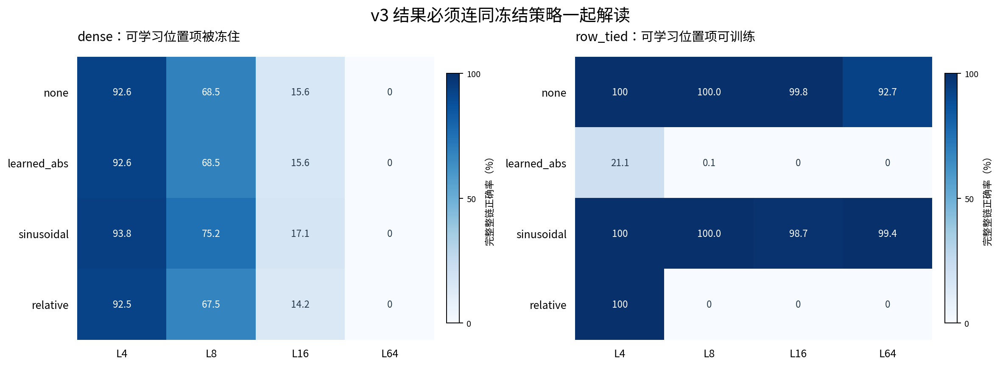

旧 FFN，4 seeds × 2 repeats。此图保留历史证据，不用于无条件比较两种路由的 PE 效应；当时没有保存规则打乱面板。

[完整数值：附表 29](数值附录.md#表-29)。

这些结果已经不支持“任何位置项都会破坏泛化”：固定正弦在旧 FFN 上有很高 L64。但是 learned_abs 的 L4 整链也很低，不能只称为长链外推失败；训练只监督第二步，L4 全步骤正确率不是训练目标拟合率。

### 12.4 理论预测与实际验证范围

原始预测认为：位置捷径可能损害长链和规则打乱，正弦偏置可能较温和，相对位置不自动保证逻辑泛化。实验支持“相对位置仍能形成长度/距离依赖”，但不支持 PE 普遍有害，也不支持原先对 dense 与 row_tied 优劣的无条件预测。冻结不一致和 FFN 混合稳健性必须纳入解释。

来源：[位置实验计划](../../notes/position-embedding-experiment-plan-2026-11-10.md)、[初始理论备忘录](../../notes/position-embedding-theory-2026-11-10.md)；三版逐运行数字均收录于本报告 CSV。初始备忘录中标准加性 PE 的展开与实际 score-only 实现必须区别理解。

## 13. 带位置偏置的 FFN 预训练

### 13.1 设计与修正

本轮重新训练 FFN，以避免“给无位置 FFN 突然加入位置项”的单一解释，同时修正 dense/row_tied 位置参数训练策略。

- **16 个 local**：4 模式×4 seeds；L1、32,768 题、batch 256、lr=.001、固定 16,000 步。Q=0，训练 FFN 与可学习位置表。
- **准入**：最终独立 L1 和遍历动作—状态组合×16 变量对达到 99.95%。16/16 实测均为 100%；不按 oracle L64 选择或早停。
- **64 个 routing**：各 local×dense/row_tied×2 数据 repeats；继承位置参数，冻结 FFN，两个路由都训练其可学习位置项；L4 second、4,096 题、2,000 步、batch 128、lr=.03。
- **评测**：正常规则顺序与随机 predicate 顺序分别保存；逻辑轨迹不变，正确规则索引随置换重映射；每长度 1,024 TF、128 greedy。

80/80 完成，失败和因准入被阻止均为 0；运行约 29 分钟。所有模式仍是 score-only 偏置，而不是将位置向量直接输入 FFN。

### 13.2 结果

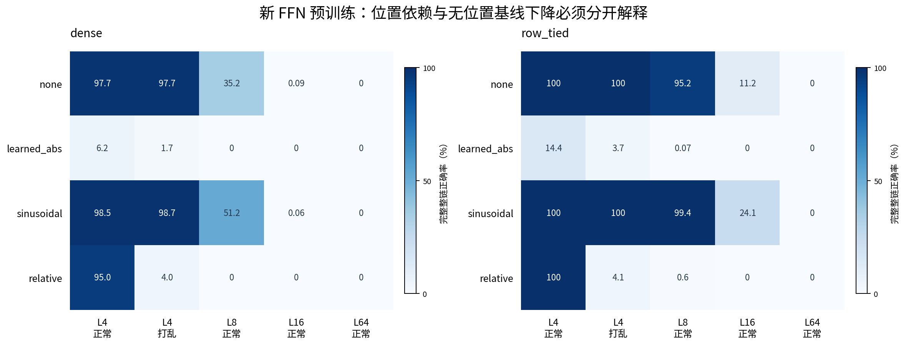

16 local + 64 routing 全部完成。可学习位置项在两种路由中统一训练；每条件 4 seeds × 2 repeats。无位置 L64 也为 0%，不能把全部失败归因于 PE。

[完整数值：附表 30](数值附录.md#表-30)。

relative row_tied 的 L4 greedy 也从正常 100% 降到打乱 2.34%，支持实际执行依赖规则排列/距离。正弦 row_tied 的 L16 正常 24.13%，打乱为 41.64%，不能用“打乱总是变差”概括所有长度和机制。

### 13.3 对位置编码假设的修正

**本轮无位置 row_tied 的 L64 也是 0%。** 与旧基线约 92.70% 相比，FFN 重训、固定 16,000 步、数据 seeds 和准入协议均改变，所以不能把所有 L64 失败归因于 PE，也不能只凭两轮结果推断长预训练有害。

局部 L1 全对不保证在长上下文注意力混合分布上可用。第 14/15 节将进一步分离“FFN 完全不会算”“规则没有选对”和“排序正确但权重不足”等解释。

来源：[预训练计划](../../notes/position-pretrained-plan-2026-11-10.md)、[结果](../../notes/position-pretrained-results-2026-11-10.md)。

## 14. 注意力集中与平衡的因果干预

### 14.1 研究设计

固定 28 个 checkpoint，按 seed 索引选择 repeat 0，不按探针成绩挑模型：Phase D 的 dense/soft1/row_tied 各 4 seeds，以及新预训练的 none/abs/sinusoidal/relative row_tied 各 4 seeds。

每模型在 L4/16/64 的 256 条新题上做 50 个条件，所有条件配对同一题目。输入为真实前缀，干预不改模型参数。

令 \(m=a_{\mathrm{rule}}+a_{\mathrm{state}}\)，\(r=a_{\mathrm{rule}}/m\)。干预包括：

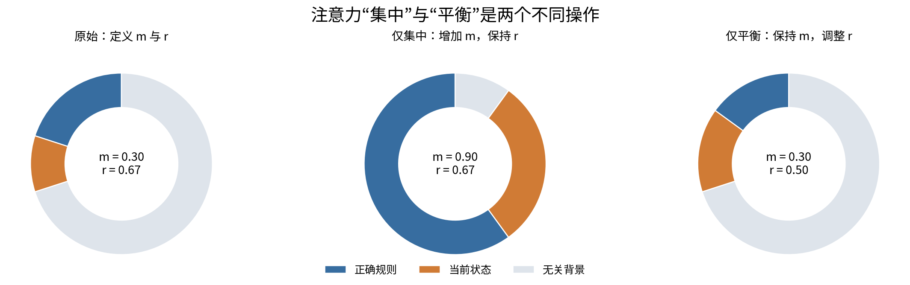

数值为操作示意，不是模型测量值。m 为两个正确位置的总质量，r 为其中规则占比。正式实验另含泄漏、二维剂量网格和逐 query 等 L1 随机对照；使用 oracle 位置。完整设计见[附表 31](数值附录.md#表-31)。

随机对照在可见 key 顶点与原注意力之间插值，不截断请求幅度；不读取正确规则位置，但接收目标干预幅度。它不是 L1 球面均匀采样，也不匹配修改位置数。所有定向条件使用正确规则位置，**只用于机制诊断，不能当作无需额外信息的推理方法**。

### 14.2 L64 干预结果

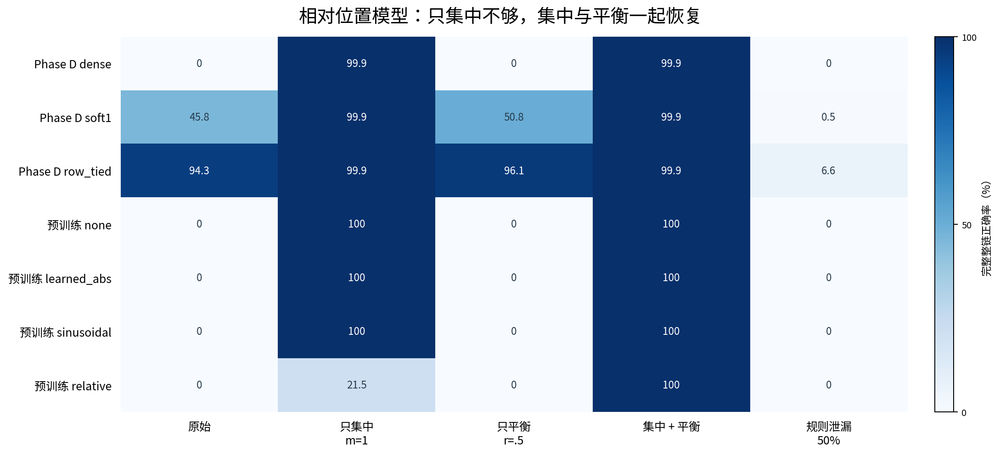

L64，7 组 × 4 seeds，repeat 0，256 题。所有预训练组均为 row_tied；此为 oracle 正确位置干预，不能视为无需额外信息的推理算法。

[完整数值：附表 32](数值附录.md#表-32)。

预训练各行都是 row_tied。relative 仅集中时的四 seed 范围为 1.17–75.39%，联合修复四个 seed 均为 100%。这表明该组的主要执行限制不是单一集中指标。

在 **m 固定为 1** 时，Phase D row_tied 的 r=.25/.5/.75 分别为 **0/99.90/50.68%**。即使全部注意力已经落在两个正确位置，混合比例仍能决定是否成功。1:1 是预先指定诊断点，不是对任意 FFN 的普适最优定理。

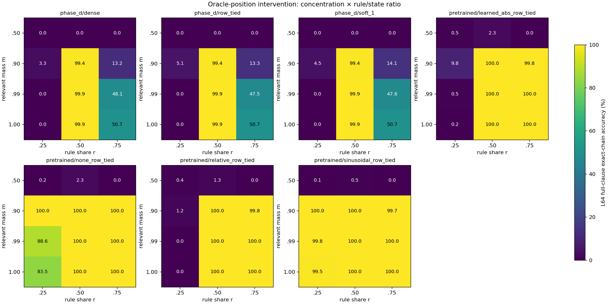

### 14.3 精确等幅随机对照

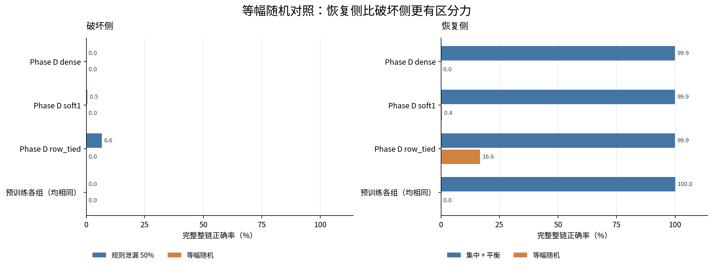

L64；随机方向先在模型内平均，再跨 4 seeds。预训练四组在这里数值均相同，合并展示；随机控制只匹配 L1 幅度，不匹配修改位置数。

[完整数值：附表 33](数值附录.md#表-33)。

随机方向先模型内平均，再跨 seeds。破坏侧随机扰动甚至更严重，因此不能宣称“移走正确规则权重比一般等幅扰动更具特异性”。恢复侧更有区分力：定向修复成功，而等幅随机没有同等恢复。

### 14.4 因果解释的范围

冻结参数后的权重干预改变了准确率，说明注意力混合是这些 checkpoint 上的可干预执行瓶颈，而不只是热图相关性。它同时改变 FFN 输入，因此正确解释需要联合考虑 FFN 对质量和比例的容忍区间。

本实验没有证明训练期间注意力集中是形成泛化的唯一原因，也没有测试偏离真实轨迹后的自我恢复。模型 hash 不变；sham 最大 logit 差 3.81e−6，预测一致；随机 L1 最大误差 5.02e−8。28 个探针全部完成，50 条件及逐样本配对结果保留。

来源：[因果干预报告](../../notes/attention-causal-results-2026-11-10.md)、[逐模型 CSV](../../runs/attention-causal-2026-11-10/per-model.csv)。

## 15. 不提供正确规则位置的推理干预

### 15.1 设计与防止测试集调参

沿用同一批 28 个 checkpoint，不重新训练。推理变换只读取输入结构和模型自己的注意力，不读取正确规则索引、变量匹配答案、动作表或目标标签。

1. **原始模型**。
2. **锐化**：\(\tilde a_j=a_j^\beta/\sum_k a_k^\beta\)，β∈{2,4,8}。这里变换完整 attention，包含位置项；与旧接口只乘身份 Q 分数的 temperature 不同。
3. **结构分组**：给所有输入 predicate 共 1/2 权重，组内按模型原注意力的 β 次幂分配；另 1/2 给当前 answer。β∈{1,2,4,8}。它知道 clause 类型和当前状态位置，但不知道哪条 predicate 正确。

先在 L4/L8、正常/打乱顺序、每面板 128 题上验证；每模型家族跨 4 seeds、长度和顺序平均成绩，分别选择锐化/分组 β，平局取最小。**全部选择写入并锁定后，才进行 L64 测试**。测试用新 seed，每长度 L4/16/64 有 256 TF、前 32 题完整 greedy，正常和打乱分别评测。

56/56 验证/测试任务完成。实现需两次前向，没有等算力比较。首次 smoke 因接口接收到 `attention_override=None` 失败，修复后保留原失败目录，再通过 smoke；非空 oracle override 明确拒绝。

### 15.2 L64 正常顺序结果

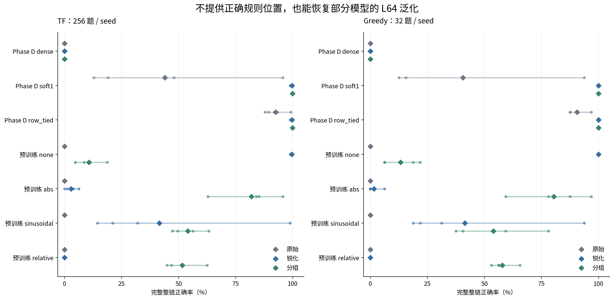

先在 L4/L8 验证集选 β，全部锁定后才测试 L64。菱形为 4 seeds 均值，小点为各 seed，横线为最小–最大范围，均不是置信区间；数据从逐模型 CSV 重算。

[完整数值：附表 34](数值附录.md#表-34)。


### 15.3 规则打乱与已选择参数

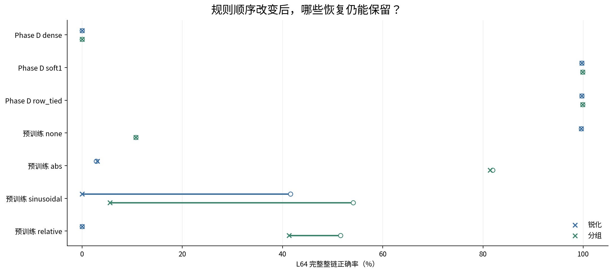

空心圆为正常顺序，叉号为打乱顺序；同色横线连接同一方法的两种顺序，重合时只显一个符号。四 seed 均值。sinusoidal 的分组恢复从 54.10% 降至 5.57%；选择的 β 见附表。

[完整数值：附表 35](数值附录.md#表-35)。

### 15.4 机制分析

- **dense：规则排序已出错。** Phase D dense 的正确规则 strict top-1 仅 84.445%。锐化和分组保持 predicate 内部排序，无法把错误第一名改成正确规则。即使分组把平均相关质量从 .4427 提到 .9076，L64 仍为 0%。
- **预训练 none：排序正确但过于分散。** 正确规则 top-1 为 100%，原始相关质量约 .232；β=2 后提高到 .795，L64 为 99.61%，四 seed 范围 98.83–100%。这定位了新基线失败的一部分机制，但尚未确定哪项预训练变化导致低 margin。
- **learned_abs：分组比全局锐化更有效。** top-1 为 100%；分组 L64 为 81.93%，四 seed 62.89–95.70%，打乱后仍 81.45%。不借助正确规则位置，也能恢复相当一部分推理能力。
- **relative：少量排序错误与混合限制并存。** top-1 约 99.21%，分组为 51.56%，打乱为 41.31%；长链对少量单步错误非常敏感。
- **sinusoidal：顺序依赖仍明显。** 分组正常 54.10%，打乱仅 5.57%，不能把固定可外推的位置表等同于对规则重排不敏感。

分组的 1/2 是给“所有规则”而不是“正确规则”，因此它不等于第 14 节的 oracle 1:1 修复。不同模型可能需要不同组内集中程度；短链选择的 β 不保证对所有长度最优。每模型仅 32 个 greedy 测试题，100% 不能外推为总体零错误。

来源：[推理干预报告](../../notes/attention-inference-results-2026-11-10.md)、[已锁定选择](../../runs/attention-inference-2026-11-10/selection.json)、[逐模型 CSV](../../runs/attention-inference-2026-11-10/per-model.csv)。

## 16. 理论解释、发现与边界

### 16.1 一个可检验的联合条件

在无位置偏置、row_tied、正确前缀和唯一规则条件下，query 变量 i 的两个正确位置联合注意力为

\[
m_i(L,t)=\frac{e^{d_{43,i}}+e^{d_{44,i}}}
{e^{d_{43,i}}+e^{d_{44,i}}+(L-1)e^{b_{43,i}}+t e^{b_{44,i}}},
\]

其中 t 是当前答案之前的旧答案数。背景项数量随长度增长，因此匹配—背景分数差需要足够大；保持固定高质量所需有效 margin 通常随 \(\log L\) 增长。

但 m 高不是充分条件，还需要：正确规则排序可靠、规则与当前状态比例落入 FFN 的可用区域，以及 FFN 对残余背景扰动有分类余量。若能在所有正确前缀上保证这些条件，则可逐步归纳得到整链正确。若只能控制每一步条件错误概率≤δ，则 union bound 给出整链失败概率≤Lδ，不要求步骤独立。

这是组织充分条件的分析框架，当前实验没有证明 Adam 必然训练到该区域。

### 16.2 位置偏置如何进入条件

实际实现为 \(s_{qk}=s^{\mathrm{id}}_{qk}+b(q,k)\)。对正确位置与任一竞争位置，若位置偏置的绝对值都≤ε，则有效分数差满足

\[
\Delta_{\mathrm{eff}}\ge\Delta_{\mathrm{id}}-2\varepsilon.
\]

单目标形式下，有 N 个可见位置时

\[
a_*\ge\frac1{1+(N-1)e^{-\Delta_{\mathrm{eff}}}}.
\]

这只是注意力分数界；当前任务需同时读规则和状态，所以还必须控制两个目标间的偏置差，以及 FFN 的混合稳健性。不能直接把这个界写成模型正确率定理。固定有限位置表也不提供无限长度保证，未训练绝对位置和距离条目不能假定已学会合理行为。

若采用真正加性 PE，分数还会出现内容—位置交叉项：

\[
(h_q+p_q)^TA(h_k+p_k)
=h_q^TAh_k+h_q^TAp_k+p_q^TAh_k+p_q^TAp_k.
\]

本系列没有实现这些完整交叉项或位置向量进入 value/FFN 的路线，因此不能用现有结果直接预测所有标准 Transformer 的 PE 行为。

### 16.3 对核心问题的回答

**什么数据和约束有利于学到泛化解？** 当前证据支持：覆盖足够的局部动作—状态组合，保持给定实际前缀的局部一致性，使变量身份与任务语义脱钩，并通过软约束、共享参数或重命名减少偶然 ID 关联；之后还需足够优化形成匹配 margin，并使 FFN 适应实际注意力混合。单独增加 pair 覆盖、缩小参数范数或保证 L1 全对都不够。

**注意力集中是不是长度泛化的原因？** 对固定 checkpoint 的权重干预已经提供执行层面的因果证据：修复相关质量和比例可恢复模型，破坏它们会损害模型。但是“集中是唯一原因”不成立；相对位置组和固定 m 的比例扫描明确显示平衡也重要，dense 的无 oracle 失败又显示排序不能忽略。

**是否有超出原文展示范围的发现？** 本项目增加了有限数据与普通 FFN 下的结构正则/重命名比较、局部一致与冲突污染的分离、等更新短题控制、score-only 位置偏置对照、精确 L1 随机注意力控制，以及先验证后测试的非 oracle 恢复。这些是相对当前原文复现范围的实证扩展；尚未完成系统文献检索，不能宣称所有现象在学术上首次发现。

### 16.4 仍未完成的问题

真正加性 PE/标准 Transformer、位置随机化训练、留出 query ID 与全局共享核、严格配对隔离 FFN 预训练预算、较大 greedy 面板和独立新 FFN seeds、以及有限样本优化收敛证明，均不能列为已完成成果。当前结果也不直接证明自然语言 CoT 或大型语言模型具有同样机制。

## 17. 审计、更正、复现与文件索引

### 17.1 已有质量控制与本次核查范围

各阶段已完成测试与冻结/哈希审计；检查数量、覆盖范围和历史记录见[质量控制明细（附表 36）](数值附录.md#表-36)。本次只重建图表与文档，不重新训练模型。

以上测试数量是各阶段记录，可能互相重叠，不能相加当成独立测试总数。本次没有重跑训练或全部代码测试；新增产物属于文档和只读汇总。

工程试跑另行保留：正式端到端实验前有 C6 seed 0 的 30-epoch pilot；稀疏模型的 4,000 步 local pilot 未通过准入；位置预训练有独立 smoke 目录；无 oracle 推理的首次接口 smoke 失败后在新目录验证。它们用于实现检查，不作为正式条件的新模型重复，也不纳入科学终点均值。

### 17.2 需要统一更正的历史口径

- 原文已经有特定条件下的可学习性结论，不能概括为“只证明存在解”。
- Phase C 终点只取 stage4，不能混入中间阶段平均。
- Phase D soft .1：完整整链 19.74%，value-only 整链 19.85%。
- 早期位置实验具有模型 seed/repeat 字段；缺陷是独立 data/noise seeds 没有充分设置，不是“完全没有 seed”。
- v1/v2/v3 的 dense 位置参数冻结与 row_tied 不同，不能据此做无条件跨路由 PE 归因。
- 旧位置实验计划中的规则打乱并没有在这些评测 JSON 中形成独立结果；新预训练实验才保存了该对照。
- 早期 relative CLI 缺失曾导致进程退出；历史“仍在运行”不能作为证据。本报告依据最终保存的 64 个完成运行确认 v3 已完成。
- 新 FFN 无位置基线 L64=0，不能把所有长链失败归因为位置编码。
- 机制 oracle 和无需正确规则位置的推理方法分开报告。
- 0% 与 100% 是有限样本观测，不是总体不可能性或普遍正确性保证。

### 17.3 文件与重建方式

- [实验总报告.md](实验总报告.md)：本报告，全部实验系列的设计、设置、结果与分析
- [Phase-B完整结果.md](Phase-B完整结果.md)：36 个条件的 L8/L16/L64 完整表
- [evaluations.csv](evaluations.csv)：标准 evaluation JSON 的逐运行、逐长度、正常/打乱、TF/greedy 记录；准确率单位为 0～1
- [aggregates.json](aggregates.json)：C/D、覆盖和早期位置实验的分组及逐 seed 均值；C 的各阶段分别保留
- [source-audit.json](source-audit.json)：本次读取文件的哈希与完成记录计数；不是所有独立训练数的估计
- [collect_results.py](collect_results.py)：从保存结果重建上述数据，不训练、不改变旧结果
- [因果干预完整数据](../../runs/attention-causal-2026-11-10/summary.json)：50 条件汇总，逐样本结果在对应模型目录
- [无 oracle 完整数据](../../runs/attention-inference-2026-11-10/summary.json)：正常/打乱、各方法、逐 seed 范围与机制统计

- [数值附录](数值附录.md)：全部 38 张原始表格。
- [图表重建脚本](visualize_report.py)：生成全部新增 PNG/PDF 图表与本报告。
- [图表来源清单](visuals/manifest.json)：图表说明、来源表格、文件哈希与主要逐 seed 数据。

标准 `evaluations.csv` 不展开机制干预专用 `result.json` 的全部条件；这些条件由上述两份专用 summary 和 per-model CSV 保存。CSV 同时保留 smoke/pilot 标记，正式结论必须排除工程运行；初始评测文件没有混入最终评测记录。

在项目根目录重建本次只读数据：

```bash
python reports/experiment-report-2026-11-11/collect_results.py
```

所有旧运行目录、失败记录与原始阶段报告均保留。各阶段实际命令以相应 `campaign-plan.json`、`manifest.json` 和逐运行 `config.json` 为准；执行历史训练命令可能受当前源码版本影响，精确复查应优先使用保存的源码快照。

## 附录 A：完整数值与导出图表

全部设置表和数值表见[数值附录](数值附录.md)，Phase B 的完整条件另见[专项附表](Phase-B完整结果.md)。每张新增图的同名 PDF 位于 `visuals/`，可直接用于演示或论文排版；[图表索引](图表索引.md)提供全部 PNG/PDF 链接。

重建本报告图表与正文：

```bash
python reports/experiment-report-2026-11-11/visualize_report.py
```
