# 什么让模型学到长度泛化？

**30 分钟报告版｜五组关键实验｜2026 年 11 月 11 日**

本稿按 **16 个展示单元、合计 30 分钟** 组织，不含问答。每个单元可以对应一页演示文稿；横线表示换页。每组实验保留研究问题、干预与控制、完整设置、读图方法和结论边界。图用于展示，正文兼作讲解提纲与听众讲义。正文后的备份材料不计入讲述时间。

讲述顺序：任务与模型 **5.5 分钟** → 结构约束 **4 分钟** → 长度课程 **3.5 分钟** → 位置偏置 **4.5 分钟** → 注意力因果干预 **6 分钟** → 无正确规则位置的修复 **4 分钟** → 结论 **2.5 分钟**。

---

## 01｜核心问题：模型为什么能把短链算法重复到长链？

**时间：00:00–01:30（1.5 分钟）**

原文 *Transformers Provably Learn Chain-of-Thought Reasoning with Length Generalization* 已经在特定架构、分布与优化条件下证明可学习性。我们关注的是这些保证放宽后的实际问题：

> **有限数据、普通 FFN 和 Adam 下，什么能让模型学到可重复执行的规则，而不只是拟合短题？**

这次报告依次检验五个问题：

1. 限制错误变量关联，是否改善长链泛化？
2. 改善是否必须依赖越来越长的训练题？
3. 加入位置信息后，模型会不会改用位置捷径？
4. 正确位置得到高注意力，是因果机制还是伴随现象？
5. 如果注意力是瓶颈，能否在不知道正确规则位置时修复？

**先给出主结论：**结构约束能促进泛化，但最终执行还取决于正确规则排序、相关信息总权重、规则与状态的混合比例，以及 FFN 对混合输入的适配性。单一“注意力集中”指标不足以解释全部结果。

**讲述提示：**本报告不追求列出所有已完成实验，而是沿着“训练找到什么解—位置改变什么—执行哪里出错—能否修复”的因果问题推进。

---

## 02｜任务：每一步既要找对规则，也要算对状态

**时间：01:30–03:30（2 分钟）**

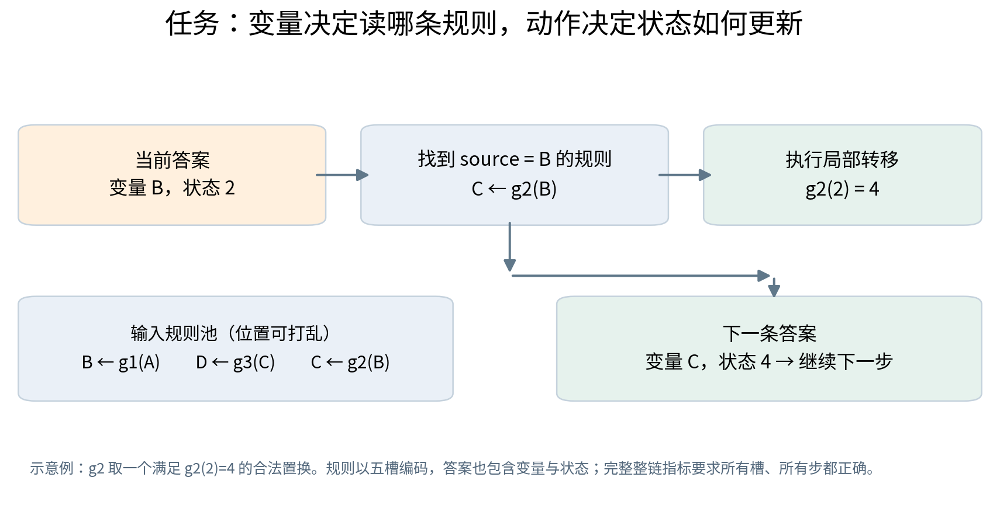

任务使用 **S5 对五个状态的置换作用**：共有 120 个合法动作，128 个变量 ID。链变量无放回抽样，动作与初始状态均匀抽样。长度 L 表示需要连续执行 L 次状态转移：

\[
y_t=g_t(y_{t-1}).
\]

规则采用五槽格式 `(目标变量, 动作, 来源变量, 0, 0)`；答案为 `(0, 0, 0, 当前变量, 当前状态)`。图中例子说明：当前变量为 B 时，需要找到来源变量为 B 的规则，再用该规则的动作更新状态。

预测下一步时，模型可以看到全部输入规则，以及已经给出的答案前缀；未来答案被因果遮罩屏蔽。规则列表通常按链的顺序排列，但逻辑任务本身由变量连接关系决定，因此**可以只打乱规则排列、保持答案不变**。

**这为什么适合机制研究？** 正确规则位置、当前状态和每一步真值均明确可知，能够分别检查“检索”和“局部计算”。五槽编码本身已经提供结构，不能把结果描述为模型从无结构自然语言中自行发现算法。

**讲述提示：**在图上走一遍 B→C 的转移。指出长链多了一方面的干扰规则、另一方面的历史答案；即使每步运算不变，检索和信息混合的难度仍可能变化。

---

## 03｜模型与指标：沿用原文理论骨架，明确我们的改动

**时间：03:30–05:30（2 分钟）**

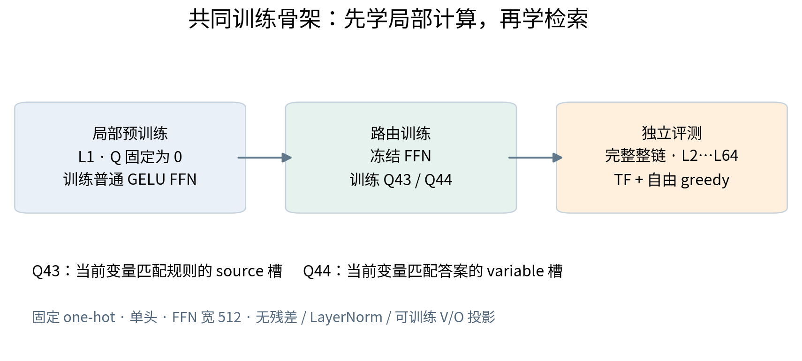

本次五组核心实验都使用同一类有限机制模型：固定 one-hot、单头、共享 GELU FFN（宽 512），无残差、LayerNorm 和可训练 V/O 投影。

- **Q43**：当前答案的变量，匹配输入规则的来源变量。
- **Q44**：当前答案的变量，匹配答案位置的变量。
- **两阶段训练**：先在 L1、Q=0 时训练 FFN，再冻结 FFN 学路由。位置预训练实验还会训练其可学习位置参数。

原文理论采用类似骨架，但具有特殊 FFN、偏置、clipping 与优化假设。我们用普通 GELU 和 Adam；软约束及 hard row_tied 是新增干预。原文附录 A 的双头实证模型对应我们另一类早期复现模型，本报告不混入那类模型的性能数字。

**主指标：TF 完整五槽整链正确率。** 每步输入正确历史，但判成功时要求全部步骤、全部槽都正确。它比“只看最终状态”严格，也不同于只检查各步 value。另做真实 greedy，把预测的全部五槽反馈给下一步。

统计先平均同一 FFN seed 内的数据重复，再跨 FFN seeds 等权平均。**4 seeds×2 repeats 只有 4 个独立局部模型**；图中的 seed 散点不是置信区间。不同实验使用不同测试面板，跨图基线小幅不同不能当作模型性能随时间改变。

**讲述提示：**这些实验主要问“有限优化协议能否得到泛化行为”，不是对任意 Transformer 的收敛证明。先把指标讲清，后面所有百分比才可比较。

---

## 04｜实验一设计：只改变路由约束，长链会怎样？

**时间：05:30–07:30（2 分钟）**

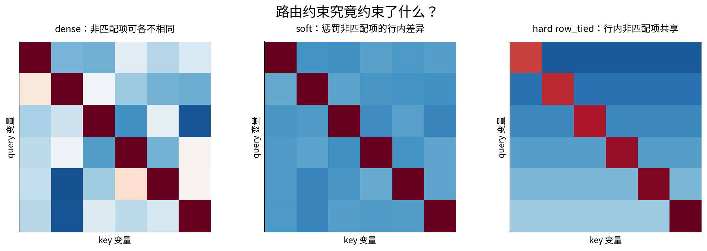

*示意矩阵，不是实测 Q。颜色相同表示分数相同；hard 每行的背景可以不同。*

**研究假设：**有限训练集可能让 dense 记住具体变量配对。压制这种非匹配 ID 偏好，应使模型更容易学习可复用的“变量相等”检索。

Phase D 比较四种处理：dense、soft λ=.1、soft λ=1、hard row_tied。dense 的两块 Q 有 **32,768** 个独立参数；soft 保留这些参数，在 CE 上加“每行非对角项偏离行均值”的平方惩罚；hard 用 \(Q_{ii}=d_i, Q_{ij}=b_i\;(j\ne i)\)，共 **512** 参数。

**固定条件：**4 个已准入 local FFN seeds×2 独立数据重复，32 个正式运行。每个 seed/repeat 内，各处理使用同一 FFN、训练数据和评测面板；从 Q=0 开始，FFN 冻结。训练 L4、4,096 题，只监督第二步 value；Adam lr=.03，batch 128，2,000 更新，累计 256,000 次 value 标签呈现。

**评测：**L2/4/8/16/32/64；每长度 1,024 TF，前 128 题真实 greedy。终点使用固定 2,000 步 checkpoint，不按 L64 选择模型。

**需要保留的区别：**hard 同时改变参数数量与 Adam 的优化几何，因此它的收益不能全归因于“残差更小”；row_tied 也不等于所有变量置换下完全不变。

---

## 05｜实验一结果：相同预算下，约束收益主要体现在长链

**时间：07:30–09:30（2 分钟）**

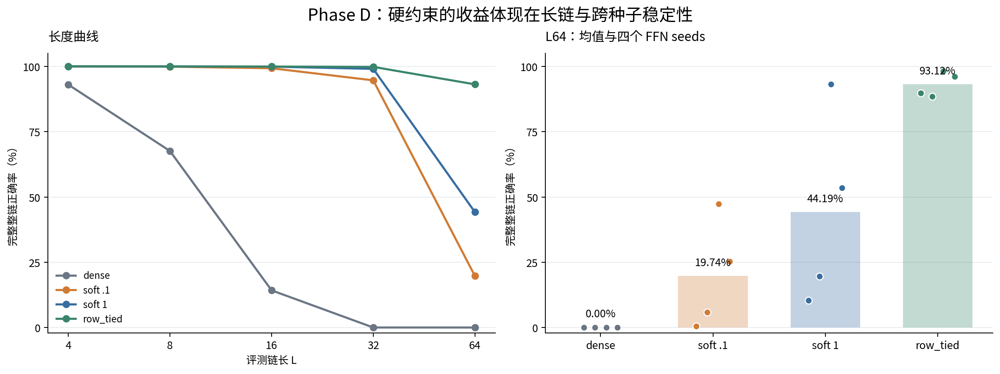

左图显示平均长度曲线；右图显示 L64 均值和四个 FFN seeds，**每个点先平均两个数据重复**。

- dense 的 L64 为 **0%**。
- soft λ=.1 / 1 分别为 **19.74% / 44.19%**。
- hard 达到 **93.12%**；四个 seed 均值为 **88.53%–98.19%**。

greedy L64 分别为 **0%、20.90%、43.75%、92.77%**，与主指标的模式一致。注意 soft .1 的 value-only 整链是 19.85%，本图使用更严格的完整五槽 **19.74%**。

**支持的结论：**在这套干净数据、固定预算协议中，结构约束显著改善长链，hard 的跨 seed 表现更稳定。soft1 的均值仍掩盖较大种子差异，因此不能只报告一个平均数就称为稳定泛化。

**尚不能推出：**dense 在任何设置下都不可能成功，或 hard 是唯一途径。更早的 1,000 步实验中，soft 和变量重命名都能改善 L16；当前结果也不是无限训练后的数学收敛结论。

**转场：**这里训练在 L4。另一种常见做法是逐步增加题目长度；下一组实验检验长度课程是否不可替代。

---

## 06｜实验二设计：长度课程还是额外训练预算？

**时间：09:30–11:30（2 分钟）**

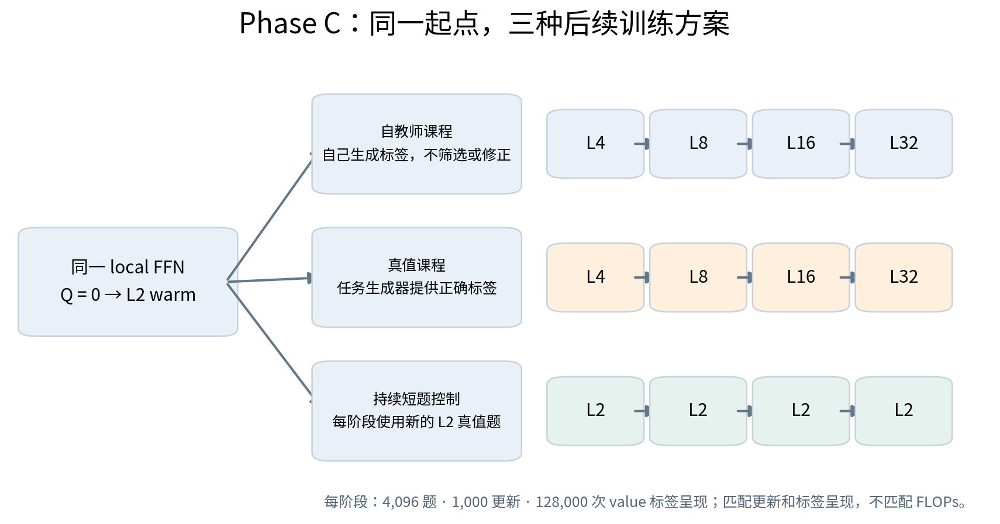

**研究问题：**自训练提高外推，是否因为模型必须接触越来越长的题？如果给相同更新预算但始终训练 L2，会怎样？

Phase C 使用 **8 个 local FFN seeds**。dense/hard 各自从 Q=0 进行 L2 真值 warmup，随后从对应 warmup 分成三条独立分支：

1. **自教师课程**：L4→8→16→32；每阶段教师是本分支上一阶段模型，完整自由生成伪轨迹。全部保留，不按真值筛选或修正。
2. **真值课程**：长度相同，目标由任务生成器提供。
3. **持续 L2**：每阶段继续训练新的短题真值。

每阶段 4,096 题、second value、1,000 Adam 更新、batch 128、lr=.03，均冻结 FFN；warmup 同为 1,000 更新，终点累计 **5,000 路由更新**。每阶段 128,000 次 value 标签呈现；匹配更新与标签呈现，**不匹配 FLOPs 或新真值标签成本**。

全部 hard seeds 先通过独立 L4 验证≥95%的 warmup 门槛，然后所有 seeds/分支完整运行。共 16 warmup+192 后续阶段，另 12 smoke；没有只留下成功 seeds。评测每长度 1,024 TF、128 greedy。

**配对边界：**分支共享相应起点，但 self 与 truth 的数据 seeds 并非完全相同，不能说训练题逐条配对。

---

## 07｜实验二结果：持续 L2 也能达到约 99.8% 的 L64

**时间：11:30–13:00（1.5 分钟）**

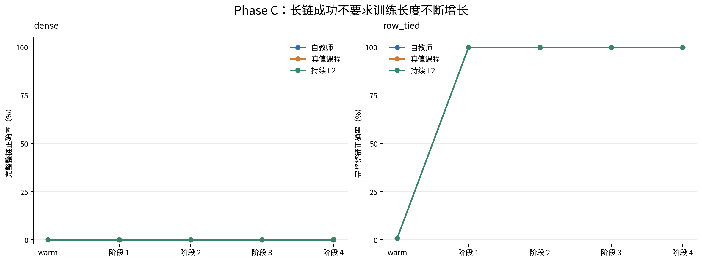

*纵轴始终是独立 L64 测试成绩，不是当阶段训练长度上的成绩；最终比较只取阶段 4。*

hard 的 warmup L64 仅 **0.87%**，最终自教师、真值课程、持续 L2 分别达到 **99.78%、99.73%、99.84%**。对应 greedy 为 **99.61%、99.41%、99.51%**；各分支均在全部八个 seeds 上表现很高。

dense 自教师与持续 L2 的终点 L64 都为 0%；真值课程为 **0.32%**。因此不能把“训练得更久”写成不依赖模型结构的充分条件。

**支持的结论：**在当前 hard 模型和预算下，增加训练长度不是高 L64 的必要条件。三条分支的微小均值差异不构成某条课程更优的证据。

**自训练的价值仍然存在：**warmup 后可用模型生成标签，避免新真值；但本实验不证明任意低质量教师都能成功，也不证明没有长度课程的所有任务都能泛化。

**转场：**结构上能学会匹配，并不保证模型总会使用这条路径。位置信息提供了另一种可能的预测线索。

---

## 08｜实验三设计：让 FFN 从预训练起接触位置偏置

**时间：13:00–15:30（2.5 分钟）**

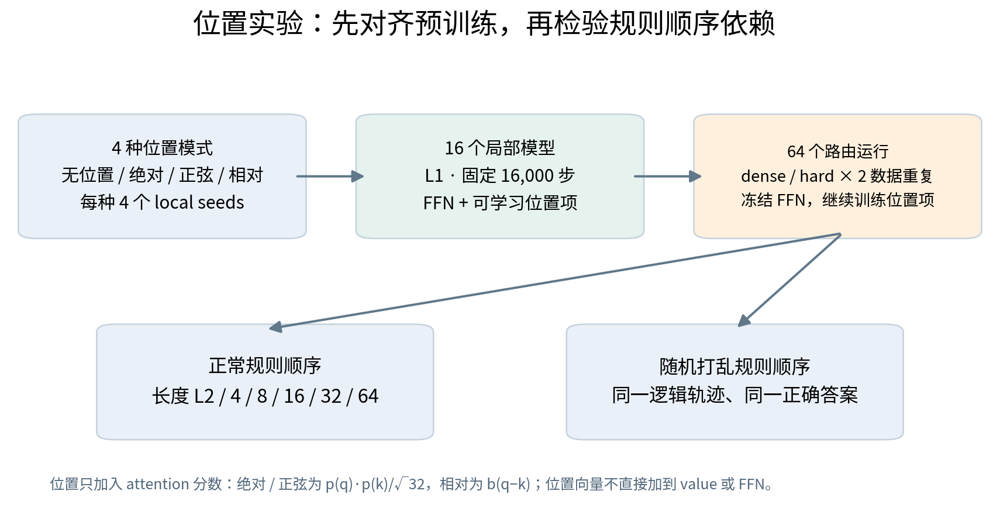

**研究假设：**固定规则排列可能让模型利用位置或距离。我们同时检验长度外推和规则顺序改变，避免只看一个长链失败数字。

四种条件：无位置；可学习绝对位置 \(p_q^Tp_k/\sqrt{32}\)；固定正弦表的同类点积；可学习相对距离表 \(b(q-k)\)。按 clause 位置索引，绝对表维度 32，上限 257；可学习位置参数初始化尺度 .02。

**实现范围：只给 attention 分数加位置项。** 位置向量不直接加到 token/value/FFN 向量；这不是标准加性 PE 或 RoPE 实验。FFN 间接看到位置项改变后的信息混合。

**阶段一，16 local：**4 模式×4 seeds，从头训练。L1、32,768 题、batch 256、Adam lr=.001，固定 16,000 步；Q=0，训练 FFN 和可学习位置项。最终独立 L1 与全部 600 个动作—状态组合×16 组变量对要求≥99.95%；16/16 全部通过，未用 oracle L64 选择或早停。

**阶段二，64 routing：**每 local×dense/hard×2 数据重复。继承位置状态，冻结 FFN；两类路由都训练 Q 和可学习位置项，正弦表固定。L4、4,096 题、second 真值、2,000 更新、batch 128、lr=.03。

**评测对照：**L2/4/8/16/32/64，正常与打乱规则顺序分别评测，每面板 1,024 TF、128 greedy；打乱只改变规则排列，逻辑轨迹和目标不变，正确规则索引同步重映射。

---

## 09｜实验三结果：相对位置仍可依赖顺序，PE 效应不能一概而论

**时间：15:30–17:30（2 分钟）**

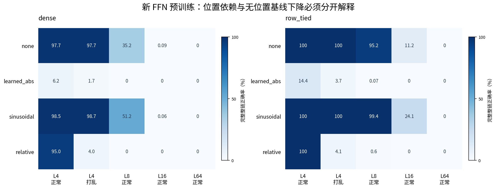

*颜色和数字为 TF 完整整链百分比。每格是 4 FFN seeds×2 数据重复的层级均值；L4 的正常/打乱比较使用相同逻辑题。*

**最有区分力的证据是规则重排：**relative hard 的 L4 从正常 **100%→4.10%**；greedy 从 **100%→2.34%**。dense relative 也从 **95.03%→3.96%**。相对位置保留平移结构，不代表自动按变量关系推理。

**绝对位置的困难更早出现：**hard 的 L4 正常整链仅 **14.43%**，不能把它称为仅仅长链失败。训练只监督第二步 value，L4 完整整链也不是训练目标拟合率。

**最重要的基线提醒：本轮无位置 hard 的 L64 同样为 0%。** 与旧 FFN 的高 L64 相比，重新预训练、固定预算、数据和准入协议都改变，尚未隔离导致基线下降的单一原因。局部 L1 全对不足以保证长上下文混合输入上的表现。

旧 FFN 的固定正弦模型曾达到 L64 **99.38%**，而本轮正弦 hard 的 L16 **24.13%** 也高于无位置的 **11.18%**。因此“加入 PE 必然破坏泛化”的预测过强。旧位置实验另有 dense/硬共享位置冻结策略不一致的缺陷，不能用旧结果作无条件跨路由归因；本轮已统一。

**转场：**这些模型的 FFN 到底不会算，还是正确的信息没有以合适比例送到 FFN？固定模型、直接改注意力，可以区分一部分解释。

---

## 10｜实验四设计：分别干预集中程度和规则—状态比例

**时间：17:30–20:00（2.5 分钟）**

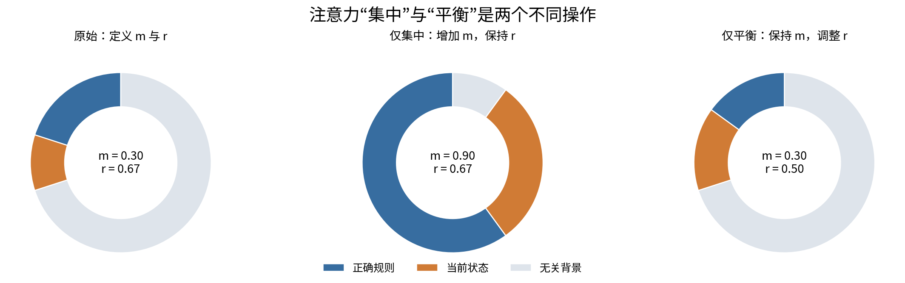

*图中数值仅用于说明操作。正式指标：\(m=a_{rule}+a_{state}\)，\(r=a_{rule}/m\)。m 是两个正确位置的总权重，不是注意力熵；r 是其中规则的份额。*

**研究问题：**性能好是否因为正确信息权重高？如果两个正确位置总权重相同，但它们之间的比例改变，会怎样？

固定 **28 个 checkpoint**：Phase D dense/soft1/hard，以及位置预训练 none/abs/sinusoidal/relative hard，共 7 组×4 seeds，均用 repeat 0；按索引选取，不按干预成绩筛选。无训练，全部参数冻结。

每模型在新的 L4/16/64 面板各取 256 题，使用真实前缀；同一题接受全部干预。共 **50 条件**，包括：

- **只集中**：保持 r，把 m 提到至少 .9/.99/1。
- **只平衡**：保持 m，令 r=.25/.5/.75。
- **联合修复**：m 至少 .99，r=.5；另有完整 m×r 剂量网格。
- **破坏对照**：把正确规则的 25%/50% 权重转给无关规则。
- **重建 sham 与随机对照**：sham 应重现原预测；9 个主要干预各配 3 个随机方向，逐 query 精确匹配 attention L1 改变量。

**诊断性质：**定向操作需要真实正确规则位置，属于 oracle 机制干预。它没有把目标状态标签输入权重函数，但也不能作为无需额外信息的推理方法。

---

## 11｜实验四结果：两个因素一起才能恢复相对位置模型

**时间：20:00–22:00（2 分钟）**

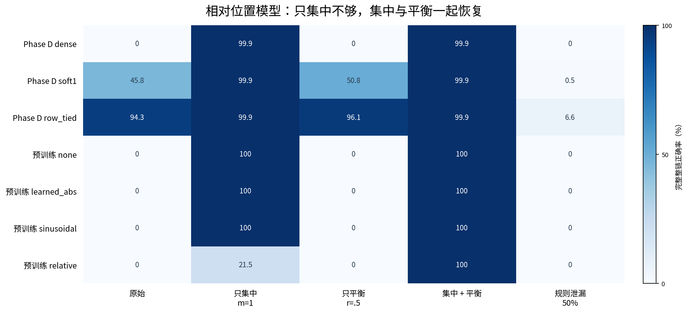

*L64，四 seed 均值。所有“预训练”组都是 hard 模型；原始、集中、比例和联合修复在相同题上配对。*

相对位置模型原始 L64 为 0%；**只集中到 m=1 为 21.48%，只平衡为 0%，集中≥.99且平衡达到 100%**。只集中时四 seeds 范围 1.17%–75.39%，联合时四 seeds 均为 100%。

这并非所有模型都需要同一种修复：Phase D dense 只集中就从 **0%→99.90%**；其余新预训练模型也能通过 oracle 集中接近完全恢复。图中保留全部模型组，避免只展示最符合假设的一例。

更直接的比例控制：对 Phase D hard，**固定 m=1**，把规则占比设为 .25/.5/.75，L64 分别为 **0% / 99.90% / 50.68%**。所有权重都已位于正确的两个位置，仍可能因混合比例不同而失败。

**结论：**注意力质量和比例具有模型相关的交互作用，不能以“足够集中”作为充分解释。这里的 1:1 是预先选择的诊断点；不同 FFN 的可用比例区间可能不同，不是普适最优值。

**讲述提示：**不要把 oracle dense 的恢复说成它原来已经会选对规则；该干预直接使用了正确位置，下一组实验会去掉这个信息。

---

## 12｜实验四对照：因果证据成立到哪一步？

**时间：22:00–23:30（1.5 分钟）**

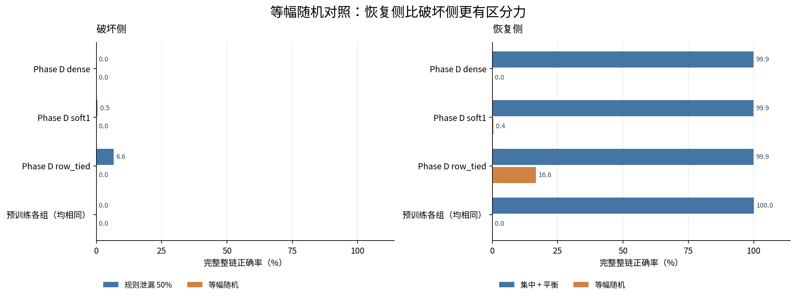

**恢复侧：**relative 的联合修复达到 100%，同 L1 幅度随机扰动为 0%。这说明不是随意改动相同大小的权重就能恢复；方向和信息结构很重要。

**破坏侧：**Phase D hard 移走一半正确规则权重后，L64 从 **94.34%→6.64%**，但等幅随机更低，为 0%。因此不能声称“正确规则定向损伤比普通扰动更强或更特异”。

模型参数 hash 前后不变；sham 预测一致，最大 logit 差 3.81e−6；随机 L1 最大匹配误差 5.02e−8。随机操作不读取规则位置，但接收目标幅度；它不是 L1 球面上的均匀随机，也不匹配修改位置数。

**能说的是：**对这些固定模型、真实前缀和样本，attention 混合是可干预的执行瓶颈。**不能说的是：**训练时集中是泛化形成的唯一原因，或该实验已证明错误前缀后的自我恢复。权重改变同时改变 FFN 输入，应联合解释。

---

## 13｜实验五设计：不提供正确规则位置，能修复多少？

**时间：23:30–25:30（2 分钟）**

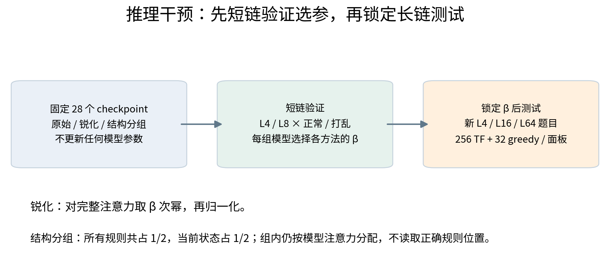

沿用同一批 28 个 checkpoint，冻结参数、不训练，比较原始模型和两种仅使用输入结构及模型 attention 的变换。

**锐化：**\(\tilde a_j=a_j^\beta/\sum_k a_k^\beta\)，β∈{2,4,8}。作用于包含位置偏置的完整 attention，保持排序；选错规则时可能让错误更自信。

**结构分组：**输入五槽格式给出规则集合 P，当前答案位置为 q：

\[
\tilde a_j=\frac12\frac{a_j^\beta}{\sum_{k\in P}a_k^\beta}\;(j\in P),\qquad
\tilde a_q=\frac12.
\]

其他位置权重为零，β∈{1,2,4,8}。它给**全部规则**一半权重，内部仍依靠模型排序，不读取正确规则位置、不比较变量来寻找答案、不访问动作表或目标标签。这是任务结构先验，并不等于 oracle 的“正确规则与状态各一半”。

**先验证再测试：**L4/L8、正常/打乱各 128 题，按模型家族与方法跨四 seeds、两长度和两顺序平均，选择 β，平局取小。全部选择锁定后，才测试新 L4/16/64 面板：每模型每面板 256 TF、前 32 题完整 greedy；56/56 验证/测试任务完成。

真值规则索引只用于事后 attention 统计，禁止传入推理函数。实现用了两次前向，未做等算力比较。无可见规则的回退分支保留原注意力。

---

## 14｜实验五结果：有的模型缺集中，有的模型选错规则

**时间：25:30–27:30（2 分钟）**

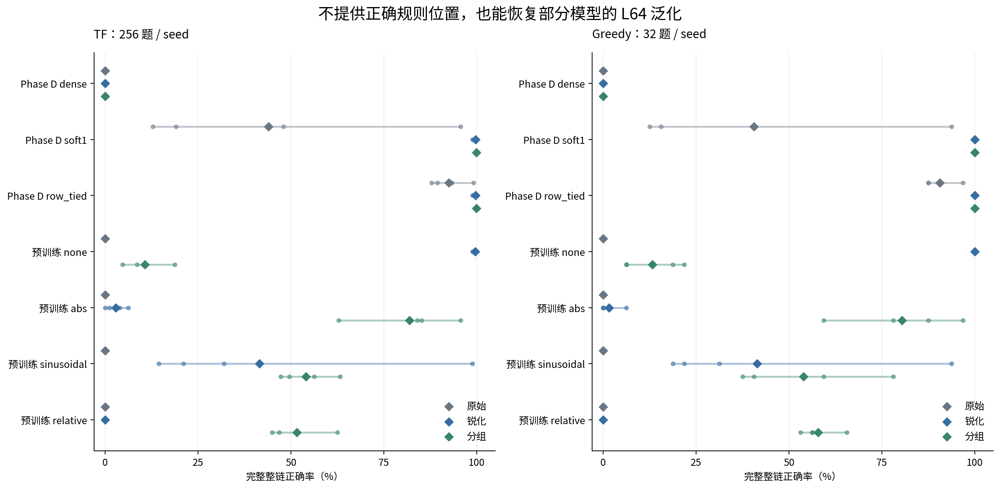

*正常顺序 L64。菱形为四 seed 均值，小点为各 seed，横线是最小–最大范围，不是置信区间。左侧每 seed 256 TF，右侧每 seed 32 greedy。*

**排序正确但太分散：**新无位置 hard 的正确规则 strict top-1 为 100%，平均相关质量仅 .232。验证选择 β=2 后，质量升至 .795，L64 从 **0%→99.61%**。这定位了当前检查点的执行瓶颈，但没有确定是哪项预训练变化使分数差不足。

**需要改变规则—状态混合：**新绝对位置 hard 分组后达到 **81.93%**，四 seed 范围 62.89–95.70%；greedy 为 **80.47%**。规则打乱后 TF 仍为 **81.45%**，这部分恢复无需正确规则位置。

**排序错误仍然存在：**Phase D dense 的正确规则 strict top-1 只有 **84.445%**，两种变换都保留规则内部排序，L64 仍为 0%。这与上一组 oracle 的约 99.9% 恢复形成机制上的区别，两个实验使用不同新面板，不能作逐题配对。

**不完整的恢复也保留：**relative 分组为 51.56%，打乱后 41.31%；sinusoidal 分组为 54.10%，打乱后仅 5.57%，顺序依赖仍明显。32 题 greedy 的 100% 不代表总体零错误。

---

## 15｜综合解释：长度泛化需要哪些条件共同成立？

**时间：27:30–29:00（1.5 分钟）**

可以把当前证据组织成一个可检验的条件组合：

**可复用的局部计算 → 正确规则排序 → 足够的相关信息质量 → FFN 可接受的规则／状态混合 → 每一步持续正确。**

这是一组联合要求，不是我们已经证明的唯一因果链。五组实验分别给出了不同证据：

- **结构训练干预**：hard 在相同有限预算下比 dense 更容易取得高 L64；soft 并非完全无效，但稳定性不足。
- **课程控制**：hard 持续 L2 也能达到约 99.8%，说明当前成功无需不断增长训练长度。
- **位置重排**：相对位置同样可能使用顺序线索；PE 类型本身不能决定泛化成败。
- **oracle 干预**：相同 m 下改变 r 仍可改变准确率；集中与平衡必须分开检验。
- **无 oracle 干预**：权重分散可以被修复，保持排序的变换无法修正错误规则排序。

一个直观的尺度解释是：竞争背景数量随 L 增加，维持高目标质量通常需要匹配分数差随 \(\log L\) 增长。但这个注意力界还必须结合比例和 FFN 分类余量，不能直接当作准确率定理。

如果每步条件失败概率最多为 δ，则整链失败概率可用 Lδ 上界控制；无需假设步骤独立。这也解释了为什么单步近乎全对，长链仍可能明显失败。

---

## 16｜结论与下一步：已经回答什么，还缺什么？

**时间：29:00–30:00（1 分钟）**

> **在当前有限模型中，结构约束能帮助训练找到可长度泛化的行为；执行失败则至少要区分规则排序、相关质量和混合比例。位置编码可以带来捷径，也可以保留可修复的规则匹配能力。**

相对原文复现，我们增加了结构约束与等预算课程控制，直接拆分注意力集中和比例的因果作用，并验证了部分恢复不需要正确规则位置。尚未完成系统新颖性检索，不把这些结果表述为已确立的“首次发现”。

**边界：**普通 FFN/Adam、固定词表与有限种子、score-only 位置偏置；没有一般收敛证明，也未覆盖标准 Transformer 或大型语言模型。

**优先下一步：**在严格匹配初始化、题目与训练预算下加入“训练时随机规则顺序”，检验能否抑制位置捷径；另做独立控制隔离新无位置 FFN 基线下降的原因。两项均是后续建议，不是已完成结果。

---

## 备份材料与复查入口（不计入 30 分钟）

**实验来源。** 五组实验分别对应 [Phase D manifest](../../runs/phase-d-structural-2026-11-10/campaign-plan.json)、[Phase C manifest](../../runs/phase-c-length-curriculum-2026-11-10/campaign-plan.json)、[位置预训练计划](../../notes/position-pretrained-plan-2026-11-10.md)、[注意力因果计划](../../notes/attention-causal-plan-2026-11-10.md)、[无 oracle 计划](../../notes/attention-inference-plan-2026-11-10.md)。

**局部 FFN 的两套来源不要混淆。** Phase C/D 沿用原先已准入模型：L1 的 32,768 题、batch 256、Adam lr=.001，按固定检查间隔达到门槛后停止；准入含局部运算及 oracle 长上下文 value/variable 检查。新位置实验则从头固定 16,000 步训练，只以最终局部能力准入，oracle L64 不用于选择。因此二者之间不能把一个差异单独归因于位置机制或训练时长。

**数据结构相关的备份证据。** 早期污染对照中，20% 错误目标令 L8 从 53.45%→0.59%，而错误前缀配上与其一致的目标为 53.61%。这说明要关注实际输入—目标局部一致性；一致组对实际输入没有局部标签错误。另一覆盖对照中，平衡配对曝光未救回 dense，不能认为仅增加当前方案的覆盖就足够。完整设计与数字见总报告第 5、9 节。

**精确软约束。** 对两块 Q，惩罚

\[
R(Q)=\frac12\sum_{b\in\{43,44\}}\frac1{n(n-1)}\sum_i\sum_{j\ne i}(Q^b_{ij}-\bar Q^b_{i,off})^2,
\qquad\mathcal L=\mathcal L_{CE}+\lambda R(Q),\ n=128.
\]

零惩罚不保证正确匹配分数大，也不保证规则与状态平衡；有限 λ 和 hard 的 Adam 轨迹不等价。

**β 如何选择。** 锐化/分组的已锁定 β 分别为：Phase D dense 4/8、soft1 2/1、hard 2/1；新 none 2/1、abs 8/8、sinusoidal 2/1、relative 2/8。每个模型家族一组参数，不按 L64 或单个 seed 再选。[原始选择文件](../../runs/attention-inference-2026-11-10/selection.json)。

[完整可视化报告](实验总报告.md) · [全部数值附录](数值附录.md) · [图表索引](图表索引.md) · [30 分钟版新增示意图来源](talk-figures/manifest.json)。

本稿共 13 个图位，使用 13 张不同图；复用的实测图来自已核对的结果，新增的 5 张图均为流程或任务示意，不伪装为实测数据。所有图均有同路径同名 PDF，可单独导出。新增示意图重建命令：

```bash
python reports/experiment-report-2026-11-11/build_talk_diagrams.py
```
