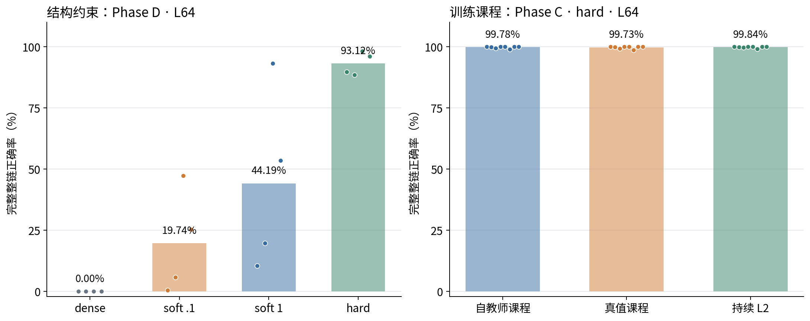
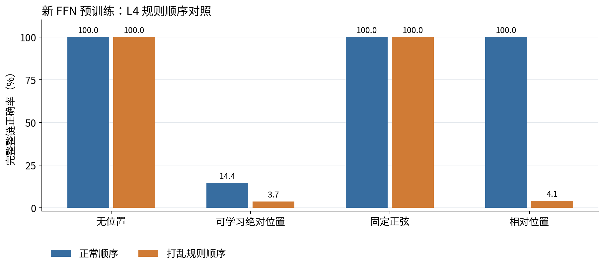
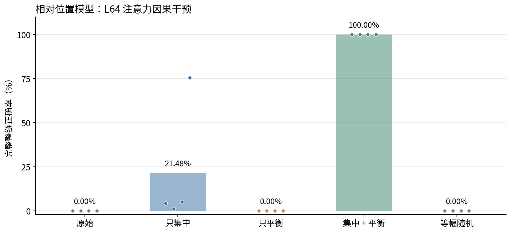
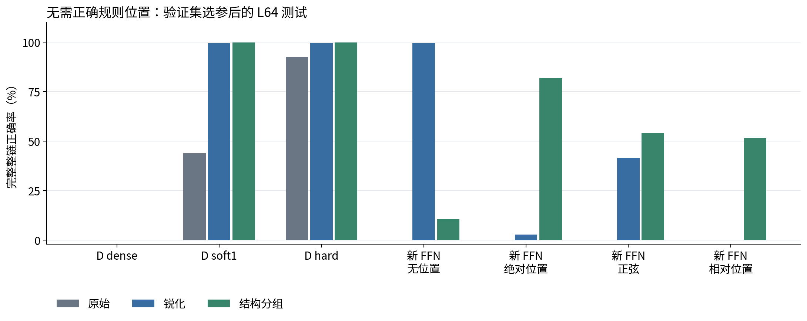

# 什么让模型学会长度泛化？

**实验汇报精简版｜2026 年 11 月 11 日｜建议讲述时长：8–10 分钟**

> **核心发现：模型必须选对规则、给必要信息足够权重，并保持规则与状态的合适比例。结构约束有助于学到这种行为，但“注意力集中”本身不是充分条件。**

## 1. 我们研究什么

原文 *Transformers Provably Learn Chain-of-Thought Reasoning with Length Generalization* 已证明特定条件下的可学习性。我们进一步问：**有限数据、普通 FFN 和 Adam 下，什么条件能让模型从短链推广到长链？**

本次汇报聚焦沿用原文理论骨架的模型：S5 状态追踪任务，单头注意力，两个变量匹配矩阵；先训练局部 FFN，再冻结 FFN 学检索。我们使用普通 GELU FFN，并新增结构约束；不是原定理全部条件的严格复现。

核心训练通常只监督 L4 的第二步状态值，评测至 L64。下文准确率均指 **TF 完整整链正确率：所有步骤、全部五槽都正确**，不是只看最后答案。

## 2. 结构约束有效，增长训练长度并非必要

*左：Phase D，4 个 FFN seeds×2 数据重复，L4、4,096 题、2,000 次 Adam 更新。右：Phase C，8 seeds，L2 warmup 后四阶段，每阶段 1,000 更新。点为逐 FFN seed 结果；两图来自不同实验，不作跨图配对比较。*

**dense** 允许每个变量配对独立学习；**soft** 惩罚同一行非匹配项的差异；**hard row_tied** 让同一行非匹配项共享参数。

- L64 从 dense 的 **0%**，升至 soft λ=1 的 **44.19%**、hard 的 **93.12%**。
- hard 模型的自教师课程、真值课程、持续 L2 训练，最终都约 **99.8%**。在该协议下，增加训练长度不是成功的必要条件；自训练仍可节省 warmup 后的新真值标签。
- 数据质量同样关键：早期配对实验中，20% 错误目标使 L8 从 **53.45%→0.59%**；污染前缀但保持局部转移一致则为 **53.61%**。后者对实际输入没有错误转移标签，不能解释为任意噪声鲁棒性。

## 3. 位置编码可能形成捷径，但不会必然破坏泛化

*重新预训练 FFN 后的 hard 模型；4 seeds×2 数据重复。打乱规则顺序保持逻辑任务不变。这里的位置项仅加在 attention 分数上，不是标准加性 PE。*

**相对位置模型在 L4 正常顺序达到 100%，打乱后只有 4.10%**，说明相对距离同样可能成为捷径。可学习绝对位置甚至在 L4 整链上就表现较差，因此不能只归结为长链外推失败。

但“加入 PE 就会失去泛化”的预测过强：旧 FFN 上的固定正弦模型曾达到 L64 **99.38%**。重新预训练后，无位置基线的 L64 也变成 0%；预训练协议等因素同时变化，不能把所有下降归因于 PE。

## 4. 因果干预：只提高集中程度还不够

*固定相对位置模型参数，4 seeds，L64 每模型 256 题。点为 seed 结果。集中＝正确规则与当前状态的总权重；平衡＝两者的相对比例。随机对照逐 query 匹配联合修复的 L1 扰动幅度，先平均随机方向，再平均 seeds。*

仅集中恢复到 **21.48%**，仅平衡仍为 **0%**，两者一起达到 **100%**；等幅随机仍为 0%。因此注意力混合是这些模型的可干预执行瓶颈，且需要同时考虑质量与比例。

**该实验使用正确规则位置，只能作为机制诊断。** 它不证明训练中“集中”是泛化形成的唯一原因，也不能直接当作无需额外信息的推理算法。

## 5. 无需正确规则位置，也能恢复部分泛化

*全部 7 组×4 seeds，固定 repeat 0；先用 L4/L8 验证集选择参数，锁定后才测试 L64。每模型 256 题 TF；图中为 seed 均值。“D”指 Phase D；新 FFN 组均为 hard 模型。*

**锐化**提高模型已有注意力分布的集中程度；**结构分组**给全部规则一半总权重、当前状态另一半，规则内部仍由模型选择。两者都不读取正确规则位置，分组使用任务结构先验。

- 新无位置模型：锐化后 **0%→99.61%**。
- 新绝对位置模型：分组后 **0%→81.93%**；真实 greedy 完整整链为 **80.47%**，但每 seed 仅 32 题。
- Phase D dense 两种方法都为 **0%**：它的正确规则 strict top-1 仅 **84.45%**，保持排序的权重变换无法纠正选错规则。

这说明“不会长链推理”至少包含两类不同失败：**已经选对但混合不合适，以及规则排序本身出错。**

## 6. 本轮可以主张什么

**数据局部一致性、匹配结构先验与足够优化共同促进泛化；执行时还要同时检查规则排序、相关质量、混合比例和 FFN 的适配性。**

本轮最有价值的扩展，是将这些因素从性能相关性推进到固定模型上的干预检验，并验证部分恢复不依赖正确规则位置。结论适用于当前有限模型与已测长度；尚未形成一般优化收敛证明，也不能直接推广到标准 Transformer 或大型语言模型。下一步最有判别力的实验是：**训练时随机打乱规则顺序，检验位置捷径能否被抑制。**

---

[完整实验报告](实验总报告.md) · [全部数值](数值附录.md) · [图表来源与绘图数据](brief-figures/manifest.json)

四张图均提供矢量 PDF：[结构与课程](brief-figures/01-structure-curriculum.pdf) · [位置对照](brief-figures/02-position-order.pdf) · [因果干预](brief-figures/03-causal.pdf) · [无需正确规则位置的干预](brief-figures/04-non-oracle.pdf)。
